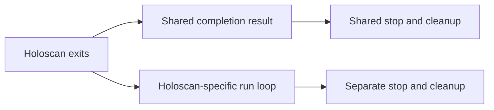
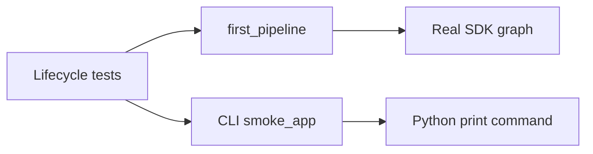
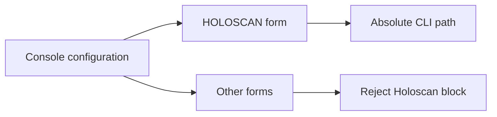
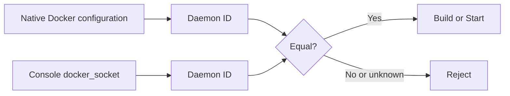
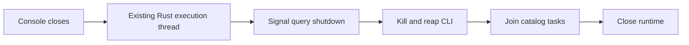
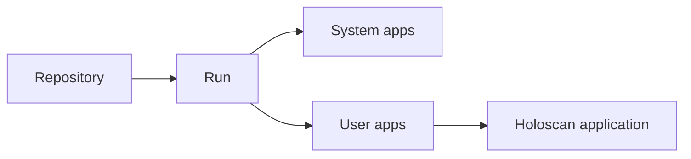
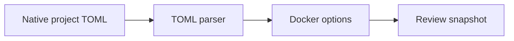

# Holoscan runner stack

Created November 16, 2026.
Plan: [#264](https://github.com/Cutuy/doramcap/pull/264).

Implement the seven runner milestones as stacked pull requests. The web app gets
its implementation plan after the application-only run works. Nothing is merged
by this task.

## Work

| Milestone | Scope | PR |
| --- | --- | --- |
| Prerequisite | Shared normal completion | [#442](https://github.com/Cutuy/doramcap/pull/442), ready |
| Prerequisite | Native Docker socket check | In progress |
| Prerequisite | Supervisor removal retry | In progress |
| 1 | Lightweight real CLI, container and overlay probes | [#444](https://github.com/Cutuy/doramcap/pull/444), ready |
| 2 | Crate, protobuf contract and discovery | [#443](https://github.com/Cutuy/doramcap/pull/443), draft |
| 3 | Prepare and Review | Pending |
| 4 | Build request | Pending |
| 5 | Application run | Pending |
| 6 | System apps | Pending |
| 7 | Recovery and acceptance | Pending |

## Agents

| Agent | Model | Assignment |
| --- | --- | --- |
| `holoscan_probe_audit` | GPT-6.1 Sol, xhigh | Milestone 1 probe tooling and qualification |
| `holoscan_contract_audit` | GPT-6.1 Sol, xhigh | Shared normal-completion prerequisite |
| `holoscan_discovery` | GPT-6.1 Sol, xhigh | Milestone 2 crate, contract and discovery |

## Decisions

The agreed decisions in #264 remain the baseline. The owner approved the
changes below during implementation.

### 1. Normal application completion — approved

Context: Holoscan must preserve the application's exit code and allow a successful
normal exit. The shared lifecycle currently treats every natural end as an error.

| Option | Effect |
| --- | --- |
| Shared completion result, recommended | Change `Running::ended` to return success or failure; preserve existing backends' behavior and shared teardown. |
| Holoscan-specific run loop | Handle normal completion in a separate lifecycle sequence owned by Holoscan. |

Choice: the owner approved the shared completion result on November 16. It keeps
lifecycle policy with its current owner and avoids duplicating teardown.

### 2. Lightweight lifecycle application — approved

Context: the owner asked for a lightweight project for lifecycle testing. The two
applications in #264 require replay data and exercise additional application
behavior. Their full acceptance remains later work.

| Option | Effect |
| --- | --- |
| Official SDK first_pipeline, recommended | Runs three CPU operators for ten values, requests stop and checks termination. |
| Official CLI smoke_app | Exercises CLI command execution without an SDK graph. |

Choice: the owner approved the unchanged SDK example with native metadata and
a small test image. It uses CUDA runtime libraries, supplied by the CUDA base and
NVIDIA runtime, without GPU computation, a dataset, model or display. The two
larger applications remain later acceptance work.

Source: [SDK first_pipeline](https://github.com/nvidia-holoscan/holoscan-sdk/tree/358c772f2d2e88d117651a961d6f6bf9b650cf8d/examples/first_pipeline).
The earlier synthetic-mode proposal was superseded by this investigation; it was
not approved or executed.

### 3. Console configuration — approved

Context: milestone 2 adds the configuration already planned in #264. Automatic
approval review required direct confirmation of those additions.

| Option | Effect |
| --- | --- |
| Planned configuration, recommended | Add `form: HOLOSCAN` and required `holoscan { cli }`; reject the block for other forms. |
| Defer configuration | Leave discovery disconnected from Console's configured backend. |

Choice: the owner explicitly approved the planned configuration on November 16.

### 4. Docker routing — approved

Context: Holoscan, system containers and Console's Engine API must reach the same
Docker daemon. Compose and Holoscan workflows do not need to run together. CLI
5.0 has no daemon host/context flag or project setting; a child `DOCKER_HOST`
override also disables its automatic local CPU-limit forwarding.

| Option | Effect |
| --- | --- |
| Matching native setup, recommended | Preserve native routing and CPU behavior; compare daemon identity before Build and Start. |
| Child DOCKER_HOST override | Select Console's socket explicitly; lose automatic local CPU-limit forwarding. |

Choice: the owner approved native setup when the daemon matches and requested
a socket-based check without a Docker subprocess. Resolve the native endpoint
from Docker configuration, then query the Engine API directly. The owner approved
implementation on November 16. Routing must remain stable during each operation;
per-command routing wrappers are unsupported. Add no environment overrides.

### 5. Catalog process ownership — approved

Context: closing Console currently kills an active catalog CLI as its runtime
shuts down, without reaping it. The cancellation check exposes a persistent zombie.

| Option | Effect |
| --- | --- |
| Existing Rust execution thread, recommended | Track catalog tasks and await child cleanup before closing their runtime. |
| Separate process supervisor | Add a dedicated component for child ownership. |

Choice: the owner approved the existing execution thread waiting for catalog
cancellation and process reaping. This adds no separate process supervisor.

### 6. Process containment and cleanup — reuse existing slices

Context: the owner asked whether detached processes and cgroups suffice, and
required idempotent pre-run and post-run cleanup across workflows. A proposed
separate CLI cgroup was superseded by the owner's instruction to reuse the
existing application slices.

| Option | Effect |
| --- | --- |
| Existing application hierarchy, owner choice | Reuse repository/run/user/application placement and cleanup. |
| Separate CLI hierarchy | Introduce another containment boundary and recovery path. |

Keep the actual `tokio::process::Child` returned by spawn until `wait()` reaps it.
Cgroup emptiness does not establish reaping. Docker owns the containers and Engine
cleanup verifies them separately. Catalog remains usable without cgroup access.

Cleanup accepts missing owned resources and resumes partial removal. It verifies
writers have stopped and preserves unrelated resources. Repeating teardown must
not replay capture or write-back. The existing inherited admission lock's effect
on orphan CLI recovery remains to be resolved in Build/Run implementation.

### 7. Native TOML parser — awaiting owner

Context: project Docker options are stored in native `pyproject.toml` and hidden
from CLI dry-run output. Prepare must read them to report mounts and conflicts.
Both candidates are already in Cargo.lock through other dependencies.

| Option | Effect |
| --- | --- |
| toml, recommended | Parse native configuration into values using the existing locked version. |
| toml_edit | Also preserve formatting for document editing, which this path does not need. |

Source: [toml-rs](https://github.com/toml-rs/toml).

## Events

- November 16: read #264 at `635cd8fd` and both repository guides. Verified the
  listed shared prerequisites, including #364, in `origin/main` at `e3fc8911`.
- November 16: started two independent read-only audits. Acquired a separate
  worktree lease for this log and the local review report; published this log in
  [#441](https://github.com/Cutuy/doramcap/pull/441).
- November 16: backend audit completed. Prepare and Build can proceed independently
  after the shared contracts exist. Later decisions concern Docker daemon identity,
  host IPC and shared overlay preparation for system apps.

- November 16: #442 is ready after scoped checks and parent review; its lease is
  released. No PR has been merged.

- November 16: published #443 for discovery. #444 is ready and its lease is
  released. Discovery remains draft during shutdown-fix review.
- November 16: the owner approved socket-only daemon checks and catalog cleanup,
  required repeatable cleanup, and directed reuse of existing application slices.
  Started the routing prerequisite and a narrow Supervisor removal retry fix.

## Left for the owner

- Decision 7: direct TOML parser dependency.
- Later decisions: private shared memory policy, unknown source identity and Build crash admission.
- Remaining implementation: Prepare, Build, Run, system apps and acceptance.
