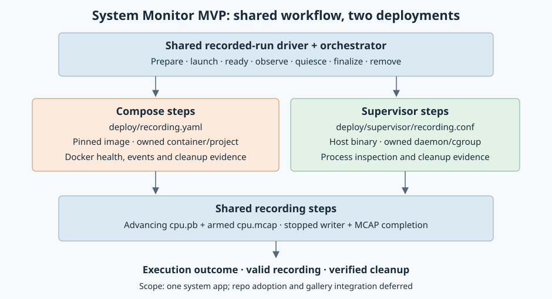

# Workload lifecycle

Shared repository admission, recording checks and cooperative recorded-run sequencing.

See [recording steps](src/recording.rs), the [shared run sequence](src/run.rs) used by Compose,
[phase hooks](src/recorded_run.rs) used by Supervisor,
and the [System Monitor deployment](../../apps/system-monitor/deploy/README.md).
The [admission API](src/admission.rs) excludes overlapping Compose and systemd work
on one repository; see its [architecture](docs/111026-admission-lock.md).
Plan: [launch forms for Compose, systemd and Supervisor](docs/110726-launch-forms.md).
[Launch contracts](proto/launch.proto) separate app configuration from the shared runtime
filled by preparation; [shared run fields](docs/110726-shared-run-fields.md) records adoption.

Shared [filesystem steps](src/capture.rs) save metadata before finalizing Linux views. Backends resolve storage, verify stopped writers and supply Engine or service-manager observations. Existing Compose step identifiers and collection-to-finalization dependencies remain stable.
