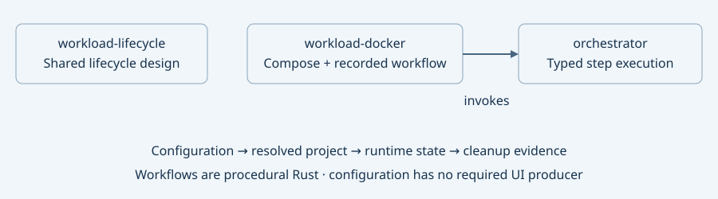

# Orchestration and workload boundaries

Created: 2026-10-26.

- [x] Separate Docker implementation into `workload-docker`; remove Docker exports/dependencies from `workload-lifecycle`.
- [x] Separate Compose project mechanics from the concrete recorded-run workflow.
- [x] Document configuration fields, ownership, errors, concurrency and cancellation.
- [x] Complete post-refactor validation and record evidence here.

Implementation evidence: `workload-docker/src/compose` owns configuration, adapter,
errors and steps; `workload-docker/src/workflows/recorded_compose.rs` owns the run
request, CPU monitor policy, runner and result. Both compile with all targets.

| Component | Responsibility | Public concepts |
| --- | --- | --- |
| `orchestrator` | Invoke transient typed steps, serialize boundaries, emit events | `Step`, `LocalExecutor`, `Input`, `Output`, `Observer` |
| `workload-lifecycle` | Mechanism-neutral lifecycle design and eventual shared contracts | No runtime API yet |
| `workload-docker::compose` | Compose resolution, resource ownership, Docker inspection and teardown | `ComposeProject`, `ResolvedComposeProject`, lifecycle steps |
| `workload-docker::workflows::recorded_compose` | Procedural run with CPU recording and ordered project shutdown | `ComposeRun`, `CpuMonitor`, `ComposeRunner`, `ComposeRunReport` |

A workflow is ordinary Rust code that calls steps. Concrete policy belongs to its
own implementation; there is no generic workflow object or experiment type.
`workload-docker` depends on `orchestrator`. It does not depend on the design-only
`workload-lifecycle` crate merely to suggest an architectural relationship.

`ComposeProject` is a configuration for one Compose project: ordered input files,
interpolation variables, profiles and selected services. It owns no live resources.
Resolution produces `ResolvedComposeProject`, including a run-specific project
name, pinned images and manifest digest. The same configuration can be resolved
for different runs.

`ComposeRun` aggregates foreign projects, supporting first-party projects and CPU
recording settings for one execution of this particular workflow. The runner owns
admission state; individual step instances own neither the entire run nor shared
service lifetimes. Configuration can come from Rust, a CLI, a file or a UI.

The neutral lifecycle crate remains a design scaffold. Extract shared contracts
when a second mechanism establishes actual common behavior; avoid generic names
for fields whose meaning is currently specific to Compose.

Step version removal remains pending review. Its current field only labels telemetry;
it neither selects a decoder nor validates compatibility.

## Validation evidence

2026-10-26: 18 local tests passed, strict Clippy and Rustdoc passed for all three
crates; formatting, whitespace, current documentation links and SVG XML checked.
The relocated real-Docker harness passed all six scenarios in 32.43 seconds,
including native CPU MCAP readback: `/tmp/doramcap-compose-split-102626`.
ARM64 job 139 succeeded at 18:52 PDT, snapshot
`5df73e3952a940dd82f292d96f2576a0`; full log:
`/tmp/doramcap-compose-arm64-139.log`. Only documentation changed afterward.
