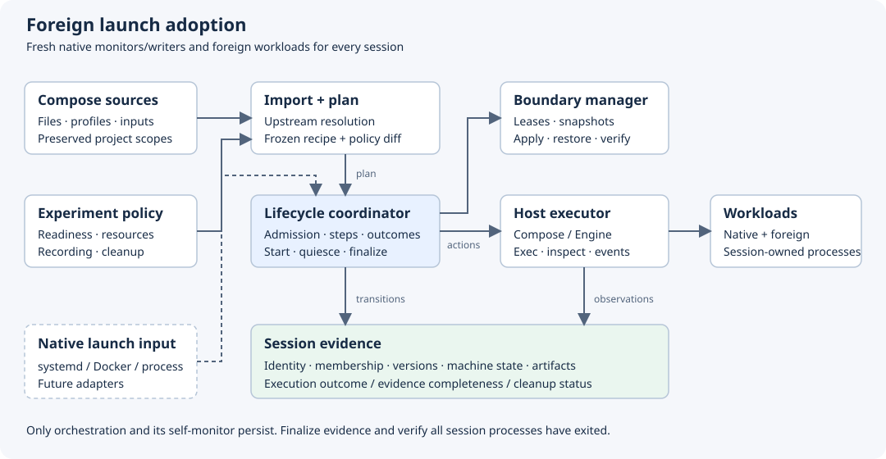
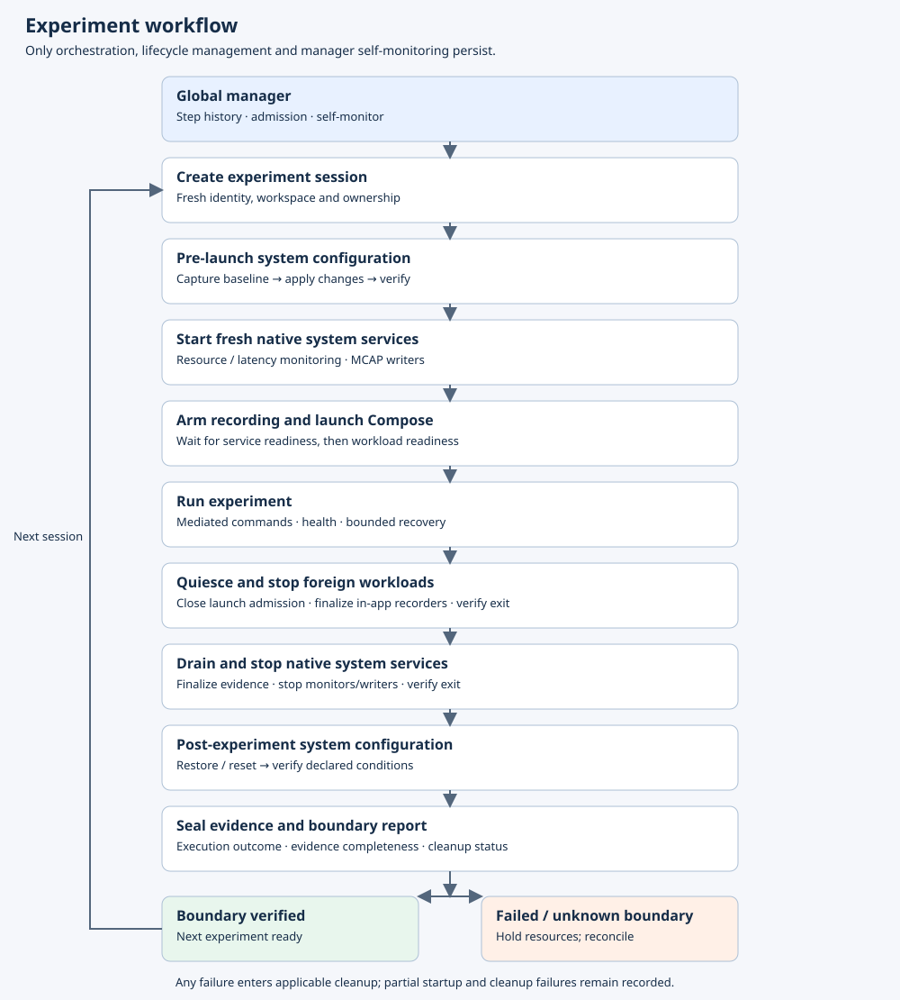
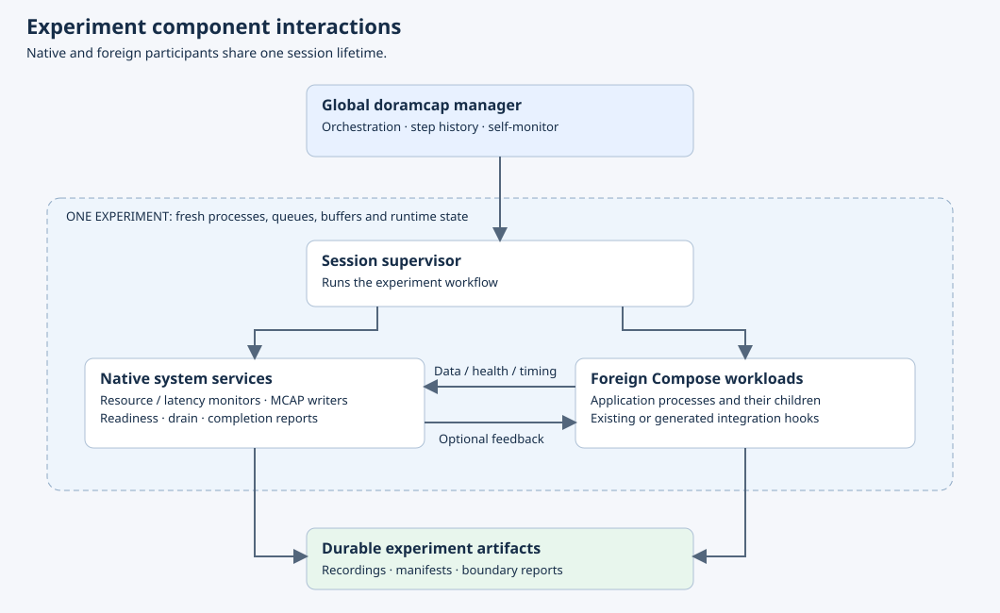

# Foreign workload adoption

Created: 2026-10-26. Status: design proposal; no execution implementation.
Owner: `workload-lifecycle`. Initial backend: Docker Compose on one host.

## Milestones and validation

- [x] Establish component ownership and inspect four pilot launch definitions.
  Evidence: [pinned source review](102626-adoption-candidates.md), 2026-10-26.
- [ ] M1: Resolve Compose imports and emit a reviewable plan with capability gaps.
  Gate: profiles, environment, paths, extends/includes, dependency conditions,
  mount ownership, and policy-conflict fixtures match a pinned Compose version.
  Adding/removing services must pass with identical workflow code and step registry.
- [ ] M2: Run vEDGAR's single-host profile through prepare, start, and finalize.
  Gate: two sequential sessions with fresh native monitor/recorder and foreign
  workload instances; all session processes exit, artifacts finalize, and residual
  resource checks and failed-cleanup admission blocking have recorded evidence.
- [ ] M3: Add AnywhereVLA project groups, mediated exec, and host helper ownership.
  Gate: terminal disconnect, helper failure, ordinary restart, and idempotent cleanup.
- [ ] M4: Add Event-Orin staged launch and composed-recorder finalization.
  Gate: readiness failure, normal stop, drain timeout, and readable final artifacts.
- [ ] M5: Add OpenTeach child observation and recorder completion contracts.
  Gate: parent failure, surviving children, missing child health, and partial files.
- [ ] Select dependencies with the user before implementation. Run applicable
  Rust/native tests and serial ARM64 CI; qualify real robotics runs separately.

## Scope and identities

Adopt foreign definitions before launch. Keep their source format and capture the
resolved execution recipe. Additional policy describes session membership,
resource constraints, readiness, evidence, and teardown. Changes to source launch
semantics appear in a reviewable diff.

Reuse [session](../../session/docs/102526-session-concept.md): an experiment groups
sessions; each session identifies one bounded attempt. A restarted participant
gets a new workload instance identity. A retried experiment gets a new session.

## Experiment lifetime invariant

Only doramcap's orchestration/lifecycle manager and its own self-monitoring persist
across experiment sessions. Native experiment monitors, MCAP writers, recorders,
and foreign workloads are created for one session and terminated before the next.
Their processes, queues, buffers, subscriptions and runtime state are session-owned.
Durable evidence and explicitly retained inputs may survive as artifacts.

Native and foreign participants can exchange data, health and latency evidence
within the session. Origin does not change the lifetime rule. Existing foreign
begin/end hooks help coordinate the boundary; they do not by themselves authorize
keeping the workload alive between sessions.

Persistent external daemons are explicit compatibility exceptions. Each exception
must identify why session-scoped launch is infeasible, its owner, retained state,
reset/verification procedure, and the resulting limitation on experiment isolation.
Attempt session-scoped launch first. An upstream daemon or boot-start default does
not automatically qualify for an exception. Experiment monitoring must remain
session-scoped; manager self-monitoring covers orchestration health only.

Native pbtxt workload launching is future scope. Possible adapters include
systemd, Docker, supervisord, and orchestrated subprocesses. Existing
resource-policy pbtxts express resource goals; a future launch specification
supplies executable/image, dependencies, readiness, and lifecycle ownership.
Foreign and native inputs can eventually feed the same execution contracts.

## Components and exchanged artifacts

| Component | Owns / produces |
|---|---|
| Import adapter | Source inventory, normalized Compose model, selected services, unresolved requirements |
| Plan compiler | Immutable launch plan, policy diff, capability report, artifact/version references |
| Lifecycle coordinator | Session transitions, step observation, admission and ordinary finalization |
| Host executor | Docker/Compose operations, exec sessions, inspect results and runtime events |
| Boundary manager | Host/device/port/output leases; declared machine preparation and restoration |
| Session-owned native services | Fresh monitors, MCAP writers and evidence adapters; snapshots, feeds and finalization reports |
| `session` | Common identities, membership and manifest contracts, evidence/completion semantics |

These are logical modules initially housed in this crate's design. Split backend
crates when implementations justify them. A future CLI/service owns user access
and hosts the coordinator. Existing telemetry and storage retain their contracts.

## Zero-code workload adoption

Hard requirement: adding a service to an existing imported Compose project requires
zero changes to orchestration code, workflow code, step registration, or a second
workload catalog. Compose remains the source of workload membership. Doramcap
resolves the project for each new experiment and discovers the selected services
and dependencies using Compose semantics, including profiles and explicit targets.

The workflow invokes generic project-level operations: resolve, launch, observe,
quiesce and stop. The adapter derives per-service instances, container ownership,
monitoring and evidence membership from resolved definitions and actual backend
objects. Dynamic service membership is data consumed by fixed workflow code.
Replica and one-off container identities must remain distinguishable. A separate
pipeline step definition per discovered service is unnecessary.

Default experiment policy automatically applies to newly discovered services.
No doramcap-specific annotations or duplicate declarations are required for basic
lifecycle ownership, process/container observation, logs, configuration/image
identity and cleanup evidence. Adopt existing health checks and stop settings.
Compose-defined profile selection still determines whether a service is launched;
discovery must not activate every profile implicitly.

An unsupported backend feature produces a precise compatibility diagnostic and is
an adapter coverage gap, not a requirement for customer pipeline code. Application
semantics that are absent from the launch definition remain explicitly unknown;
readiness, message causality or recorder completeness must not be invented.
Existing hooks or automatically generated/qualified integration may enrich those
semantics without making customer code changes the default onboarding path.

Validation gate: add a service and dependency to a fixture Compose project, then
run the identical workflow. Verify automatic discovery, session membership,
observation and cleanup. Repeat for removal, rename, profiles and replicas; record
that workflow source and step registry are unchanged.

## Resolve and plan

1. Capture each Compose project's file order, working directory, selected profiles
   and services, interpolation inputs, and Compose version. Independent projects
   stay separate; their cross-project dependencies are explicit.
2. Use upstream `docker compose config` for normalization. Preserve commands as
   executable content; shell behavior and dynamic ROS/Python launch graphs need
   declared actions or application adapters.
3. Prepare builds/pulls as separately recorded preparation work. Capture image
   IDs/digests, source revision plus dirty content, model/calibration inputs, and
   writable mount state. Build work can affect the machine baseline.
4. Apply a policy overlay with explicit precedence and conflict diagnostics.
   Validate required guarantees; retain requested, translated, and observed policy.
5. Freeze the plan and inputs before activation. Recheck mutable files or snapshot
   them; a digest without stable inputs cannot prevent launch-time drift.

Compose remains the initial execution delegate as well as resolver. Doramcap
controls its invocations and reconciles Engine state. A direct Engine translator
is a later alternative requiring feature-by-feature semantic qualification.
Profile selection, dependency health/completion, one-shot services, networks,
volumes, secrets and build behavior must survive either route.

## Launch and restart authority

| Boundary | Authority |
|---|---|
| Session start/stop and container replacement | Doramcap |
| User exec/run/interactive session | Doramcap admits, records, attaches and closes |
| ROS respawn / Python workers inside a workload | Explicitly delegated to the inner supervisor |
| Exceptional external daemon | Explicit exception contract names its owner and reset/verification obligations |

The strict initial container policy disables autonomous Docker restart and routes
retries through doramcap. This is a recorded overlay change. Delegating Docker
restart later needs durable policy, restart identities, and a way to prevent
restarts during session finalization. Never assign two retry loops to one boundary.

A mediated shell owns an exec session and its descendants. Typed shell commands
and every internal fork are not automatically separate authorized actions.
Per-child admission or exact command provenance requires application cooperation
or qualified instrumentation. Each exec has an identity and disconnect/timeout
policy; terminal closure does not establish process completion.

Enforcement requires controlling all reachable Engine endpoints and credentials,
including socket mounts and remote contexts. Docker-group users or host root can
bypass a cooperative wrapper. Privileged workloads weaken containment claims.
Declare cooperative or enforced operation and record external mutations.

## Session boundary protocol

The global manager creates the session before pre-launch configuration and records
baseline, applied changes and restoration through its step history/self-monitoring.
Fresh experiment monitors and writers start after configuration and stop before
post-experiment restoration. The manager verifies their exit and postconditions.

- Pre-launch: lease required resources, capture baseline, apply configuration and
  verify it. Start native services, arm recording, then launch foreign workloads.
- Run: use application readiness evidence and declared deadlines; mediate user
  commands and recovery. Native and foreign services can exchange payloads,
  health reports, and timing context through qualified integration hooks.
- Stop: close launch/restart admission; quiesce applications and finalize any
  in-process recorders while their required dependencies remain alive. Stop foreign
  workloads, then drain/finalize and stop native system services.
- Restore: verify every session-owned process exited, restore/reset system state,
  verify declared postconditions, and seal the evidence report. Restore only owned
  changes; unexpected changes require reconciliation.
- Failure: run applicable cleanup after partial startup or execution failure.
  Preserve execution outcome, evidence completeness and cleanup status separately.
  Unknown or failed boundary verification blocks the next conflicting experiment.

Workflow steps will use the separate
[orchestrator crate](../../orchestrator/docs/102626-function-steps.md).
The workflow is authored as ordinary async code; its observed dependency graph
and step history are derived from execution. Customer-facing pbtxt supplies
experiment parameters and resource goals. It does not declare workflow steps or
edges. Optional orchestrator settings are separate from pipeline structure.
Compose is imported workload configuration; domain lifecycle semantics stay here.

Cleanliness is relative to declared checks. Output directories, persistent volumes,
GPU contexts, device state, thermal conditions and external robot services need
specific reset/acceptance contracts. Process termination alone proves none of these.
Classify every resource by ownership and retention; preserve external data and
explicitly retained artifacts. Surviving services must match an approved exception
contract. Fresh output directories avoid silently reusing an earlier episode.

## Idempotence and evidence

Use the [simple orchestrator](../../orchestrator/docs/102626-function-steps.md):
serializable coroutine steps, one local event loop and ordinary error cleanup.
Procedural Rust workflows call transient Rust step structs through shared context.
Python/Node steps can use the bounded JSON stdio adapter.
Setup ensures desired state; stop tolerates already-absent owned resources. Use
stable session/workload names and verify ownership before changing existing state.
Steps clean partial failures; the workflow explicitly drains/stops participants
and restores configuration in its ordinary error path.

Record source and resolved-plan fingerprints, image/build identity, mount/input
provenance, applied policy, configuration reports, commands, instance transitions,
and artifact completeness. This evidence is for inspection. Automatic resume,
crashed-orchestration detection and durable recovery machinery are outside scope.

Multiple hosts remain a design consideration only: include executor identity in
step records and paths. Future calls may target one or all executors; implement
no remote execution or distributed coordination now.

## Reuse candidates for evaluation

| Candidate | Proposed role / qualification |
|---|---|
| Docker Compose CLI | Upstream resolution and initial execution; pin version and fixture semantics |
| `compose-go` | Upstream reference loader if an embedded helper becomes worthwhile; Go boundary |
| `bollard` | Rust Engine client for inspect/events/exec; evaluate API compatibility and maintenance |
| Existing `prost`, `sha2`, `pbtxt-config` | Typed policy/records and deterministic digests where contracts fit |
| Existing resource/telemetry/session components | Reuse domain ownership; record adapter coverage explicitly |

No dependency is adopted by this scaffold. GPU device selection and SM partitioning
are separate capabilities; opaque containers cannot promise green-context or exact
SM placement from a generic Docker resource request.

## Automatic integration moonshot

Goal: a repository and experiment intent are sufficient for routine adoption.
An integration agent inspects launch/configuration code, proposes a versioned
adapter, exercises it in a qualified environment, tests shutdown/reset, and
retains the evidence. Prefer running integration agents off-device or on demand.
Experiments execute a frozen adapter revision; repairs create a new revision.
Physical state, recorder completeness and safe reset require observable contracts.
Agent inference alone cannot establish successful boundary verification.

## Design correction evidence

2026-10-26: simplified orchestration to one local coroutine executor, serialized
step boundaries and idempotent operations. Removed automatic manager recovery and
remote implementation requirements. Updated charts to show observational history.

2026-10-26: saved the agreed workflow and component flowcharts. Aligned ordering:
pre-launch configuration → fresh system services → foreign workloads → workload
stop → system-service drain/stop → post-experiment restoration and verification.
The global manager records configuration phases outside experiment monitoring.

2026-10-26: user clarified that experiment monitors and writers must terminate
between experiments. Updated the lifetime invariant, authority table, teardown
sequence, pilot gates and feasibility criteria. Persistent external daemons are
compatibility exceptions; only orchestration/lifecycle management and its own
self-monitoring persist by design. Runtime validation remains pending.

## Scaffold validation

2026-10-26: `cargo check -p workload-lifecycle --offline` passed. The crate has
no dependencies or executable behavior. Local Markdown links resolved, the SVG
parsed as XML, and `git diff --check` passed. The new experiment workflow and
component-interaction SVGs were rendered and visually reviewed on 2026-10-26.
Robotics execution, Docker integration, native capability tests and ARM64 runtime
qualification remain future milestone gates.

## Sources

- [Compose normalization](https://docs.docker.com/reference/cli/docker/compose/config/)
- [Compose readiness/order](https://docs.docker.com/compose/how-tos/startup-order/)
- [Docker restart behavior](https://docs.docker.com/engine/containers/start-containers-automatically/)
- [Docker event history](https://docs.docker.com/reference/cli/docker/system/events/)
- [Engine access boundary](https://docs.docker.com/engine/security/)
- [compose-go](https://github.com/compose-spec/compose-go) · [Bollard](https://github.com/fussybeaver/bollard)
