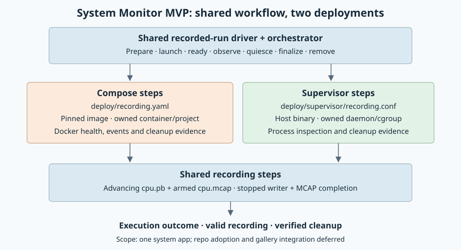

# System Monitor through Supervisor

Created: 2026-10-29. Status: complete. All four milestones validated on x86_64 and ARM64.

Run the existing `apps/system-monitor` binary through a first-party Supervisor
template. Exercise preparation, readiness, observation, cooperative stop,
recording finalization and verified cleanup using the same lifecycle driver as
Compose. One system app is the complete workload for this MVP.

## Scope

- Add `apps/system-monitor/deploy/supervisor/recording.conf`; keep usage in the existing app deployment README.
- Keep the existing Compose recipe at `deploy/recording.yaml`.
- Run one dedicated Supervisor daemon and one monitor program in an owned cgroup.
- Use a prebuilt monitor binary with BPF support and explicit host prerequisites.
- Defer foreign-config adoption, gallery integration, multiple apps, Dora,
  mixed backends, automatic environment installation and native filesystem overlays.
- Preserve ownership evidence on interruption. Automatic restart recovery is deferred;
  an unfinished owned run must block reuse until its cleanup is verified.

## Reuse boundary

| Component | Shared implementation | Backend implementation |
| --- | --- | --- |
| Execution | Existing `orchestrator` steps, events and dependency lineage | Step registration and adapter state |
| Recording | `Recording`, readiness probe, MCAP completion check | Monitor deployment recipe and output-path binding |
| Workflow | Prepare/launch/observe/stop/finalize/remove sequencing, cancellation and cleanup continuation | Concrete phase operations and evidence |
| Outcome | Execution error, writers stopped, recording finalized, cleanup verified | Docker diagnostics or Supervisor process diagnostics |
| Ownership | Admission rules and attempted-resource ledger contract | Docker resources or daemon/cgroup identities |

Extract recording code from `workload-docker::workflows::system_apps` into
`workload-lifecycle::recording`, retaining re-exports for existing callers.
Compose-specific preparation and `SystemAppsConfig` remain in `workload-docker`
unless a field genuinely becomes shared. Neutral error types must not depend on Docker.

Add one ordinary async recorded-run driver in `workload-lifecycle`. A small typed
phase interface binds each backend's steps to that driver. It owns phase order,
readiness notification, observation/cancellation, and best-effort completion.
Concrete wrappers retain their own run specifications and reports. Derive the
interface from these two callers; do not add a workflow DSL or universal service schema.

Compose hooks retain OverlayFS, Dora, Docker event capture and resource-removal
gates. A mandatory final cleanup hook closes background observers even when an
earlier phase fails. Failed finalization must not skip safe cleanup, and cleanup
must not discard evidence required by the backend. Preserve Compose's conservative
admission behavior and existing report fields.

## Proposed files

| Location | Purpose |
| --- | --- |
| `apps/system-monitor/deploy/supervisor/recording.conf` | Fixed first-party program recipe |
| `libs/workload-lifecycle/src/recording.rs` | Shared recording steps |
| `libs/workload-lifecycle/src/recorded_run.rs` | Shared lifecycle sequencing and outcomes |
| `libs/workload-supervisor/src/` | Native ownership, adapter and typed steps |
| `libs/workload-supervisor/proto/` | MVP run configuration and durable ownership evidence |
| `libs/workload-supervisor/examples/supervisor_monitor.rs` | End-to-end monitor run using generated protobuf settings |

The fixed template uses environment substitutions for the absolute binary and
run directory. Preparation creates a private daemon configuration with its own
Unix socket, PID file and log paths. Validate/escape generated values or reject
unsupported characters. No arbitrary INI importer is needed.

Program policy: `autostart=false`, `autorestart=false`, graceful TERM, bounded
stop wait, and process-group stop/kill. The runner explicitly starts the program
after establishing ownership. A monitor restart ends this recording attempt.
Supervisor priority does not replace the shared readiness barrier.

## Dependencies for evaluation

Reuse existing Tokio, prost, rustix/libc and orchestrator facilities where suitable.
Supervisor itself is the requested external runtime; orchestration remains Rust.

| Control option | Evaluation |
| --- | --- |
| Official `supervisorctl` | Smallest integration, no new Rust protocol dependency; verify timeout, cancellation and status semantics before choosing |
| `quick-xml` + existing HTTP transport | Recommended candidate for structured XML-RPC if CLI semantics are insufficient; requires a narrow protocol adapter and fault handling |
| `xmlrpc` | Dedicated protocol client candidate; evaluate current maintenance, async/cancellation and Unix-socket transport before adoption |

References: [Supervisor API](https://supervisord.org/api.html),
[Supervisor configuration](https://supervisord.org/configuration.html),
[quick-xml](https://github.com/tafia/quick-xml),
[xmlrpc](https://docs.rs/xmlrpc/latest/xmlrpc/).
Selected: official `supervisorctl`, presented for evaluation before implementation.
Tokio bounds each direct control subprocess, kills and reaps on deadline, and uses
kill-on-drop on cancellation. Fixed-program status parsing accepts only RUNNING
and records PID/start ticks; any generation change ends the attempt. Native tests
verify CLI nonzero exits, timeout, readiness and stop behavior on Supervisor 4.2.5.

`quick-xml` is a maintained XML reader/writer, requiring an XML-RPC envelope/fault
adapter plus Unix HTTP transport. `xmlrpc` 0.15.1 offers protocol values and a
transport abstraction; its documented optional reqwest 0.11 transport would still
need Unix-socket and cancellation integration. Neither adds value for this fixed
program interface. No new third-party package/version was added to Cargo.lock;
existing Tokio/prost/prost-reflect/serde/libc/hash dependencies are reused.

## Milestone 1: Deployment contract

**Work items**

- [x] Add the fixed monitor recipe and usage in the existing deployment README.
- [x] Define generated protobuf inputs: run identity, new output directory,
  supervisor/control executable locations, monitor binary, readiness/stop deadlines,
  and the delegated cgroup location. Use pbtxt for examples.
- [x] Match the Compose command: BPF backend, 32,768 records, `cpu.pb`, `cpu.mcap`,
  buffered recording. Retain logs and config/binary identity beside outputs.
- [x] Record the selected control approach and dependency evaluation.

**Validation**

- [x] Validate the template with the supported Supervisor version, including paths
  containing spaces and unsupported interpolation characters.
- [x] Reject missing binaries, unavailable BPF access or cgroup delegation before
  launching the monitor. No automatic sudo or host configuration mutation.
- [x] Confirm TERM reaches the existing monitor shutdown handler and closes MCAP.

Evidence (2026-10-29): fixed recipe matches Compose flags; generated `MonitorRun`
and `Ownership` types are used directly with strict pbtxt parsing. Supervisor 4.2.5
accepted executable/output paths containing spaces and completed MCAPs after TERM.
Unit tests reject interpolation/comment/control characters, missing executables
and unknown fields. `--check-bpf` verifies real kernel attachment before daemon
resource creation. Unprivileged BPF and cgroup-delegation probes failed before
output creation/daemon launch, as expected. No application sudo or host setup.
Logs: `/tmp/supervisor-native-final.log`, `/tmp/supervisor-ci-tests-default.log`,
`/tmp/supervisor-unprivileged-bpf.log`, `/tmp/supervisor-preflight-denied.log`.

**Status:** complete.

## Milestone 2: Shared recording steps and lifecycle driver

**Work items**

- [x] Move `Recording`, `WaitForSystemApps` and `FinalizeSystemApps` behavior into
  the neutral crate, with compatibility re-exports and backend-neutral errors.
- [x] Extract the sequencing driver and adapt `ComposeRunner` to use it. Keep
  preparation, Docker events, filesystem and Dora work in Compose phase hooks.
- [x] Permit a system-app-only Compose run when a monitor is configured;
  continue rejecting runs with neither projects nor supporting apps.
- [x] Gate finalization on writer quiescence. Record execution, finalization and
  cleanup outcomes independently without weakening existing cleanup gates.

**Validation**

- [x] Contract tests cover successful phase order, readiness failure, cancellation
  during launch, quiescence failure and finalization failure with safe cleanup.
- [x] Verify no readiness notification after cancellation or failed probes.
- [x] Run existing Compose lifecycle/recording tests and a real monitor-only
  Compose run. Confirm existing app/Dora and overlay behavior is preserved.

Evidence (2026-10-29): neutral recording steps retain compatibility re-exports;
both wrappers invoke `recorded_run::run`. Compose retains Docker events, Dora,
filesystem/removal gates and independent outcomes. Contract tests cover phase
order, launch/readiness failure, cancellation, quiescence/finalization failure
and mandatory finish. Backend phase futures and Compose preparation are boxed to
bound caller stack use; native tests run with their default thread stack.

All five existing native Compose tests passed, including partial launch, failed
readiness, cancellation barriers, direct-session recovery, retained evidence and
nested cleanup. All 12 native OverlayFS tests passed. Updated an obsolete direct
lineage assertion to verify the existing nested phase parent/dependency chain
and the temporal writer-quiescence barrier. The Compose harness now supplies its
socket/touch fixtures, runs serially, and accepts a Cargo profile (default `ci`).
Real Dora embedded/published recording comparison matched 24 snapshots/26 messages.

Logs: `/tmp/supervisor-compose-regressions-final2.log`, `/tmp/supervisor-overlay.log`,
`/tmp/supervisor-dora.log`. Artifacts: `/tmp/supervisor-compose-regressions-1029d`.

**Status:** complete.

## Milestone 3: Supervisor steps on the shared driver

**Work items**

- [x] Add typed prepare, launch, inspect, quiesce and remove steps in
  `workload-supervisor`, registered on the existing executor.
- [x] Persist ownership intent before spawning; establish the daemon's cgroup
  before it can create descendants. Keep runtime handles out of serialized inputs.
- [x] Launch the monitor explicitly, invoke the shared recording readiness step,
  inspect liveness until stop, then quiesce and use shared recording finalization.
- [x] Bound control calls, stop the owned daemon, reap it and verify the cgroup is
  empty. Retain diagnostics and block reuse on unknown ownership or cleanup failure.
- [x] Add a thin Supervisor run wrapper and the System Monitor example using the
  same driver as Compose. Record how to diagnose an abandoned MVP run safely.

**Validation**

- [x] Run a real native monitor and read its completed MCAP with existing readers.
- [x] Inject startup failure, early monitor exit, stop timeout and manager-future
  cancellation. Verify attempted resources remain accountable and teardown runs.
- [x] Verify descendant cleanup, daemon reaping and two concurrent runs with
  separate sockets, cgroups and output directories.
- [x] Confirm forced termination never reports recording success for truncated MCAP.
- [x] Confirm incomplete ownership evidence blocks reuse without signaling unrelated PIDs.

Evidence (2026-10-29): typed steps retain live child/cgroup-kill handles;
fsynced protobuf intent precedes cgroup creation/spawn. Pre-exec placement occurs
before Supervisor can fork. Removal verifies boot/device/inode, empty subtree
and reaped daemon. PID/start ticks detect monitor generation changes. Every
control call selects the private config, has a deadline and bounded output.

Final native suite: two tests passed, covering daemon startup failure, early
monitor exit, failed readiness without notification, TERM-resistant monitor with
a descendant, cancellation during launch, manager-future drop and blocked reuse.
Forced stop rejected the truncated recording. Dropped futures killed their owned
subtree while leaving incomplete durable evidence and blocked admission. Unknown
or mismatched cgroup identities are rejected without PID signaling. Concurrent
real BPF runs produced readable MCAPs and removed separate cgroups/sockets.

Logs: `/tmp/supervisor-native-final.log`. Final concurrent-run artifacts:
`/tmp/supervisor-tests-509713-1793318580641694155`. Native tests built unprivileged;
only test executables/helpers received capability elevation and memlock limits.

**Status:** complete.

## Milestone 4: Demonstrate backend parity

**Work items**

- [x] Provide runnable Compose and Supervisor monitor-only examples with the same
  recording policy, cooperative stop and outcome summary.
- [x] Add a compact architecture/usage link and record the native host prerequisites.
- [x] Update library-boundary rules for the neutral extraction and new backend.

**Validation**

- [x] Compare semantic outcomes: advancing CPU stream, readable MCAP, graceful
  stop and verified cleanup. CPU sample values need not match across runs.
- [x] Compare emitted lifecycle phase order and shared recording-step events.
- [x] Run final-revision local CI: boundaries, formatting, default/all-feature
  Clippy and workspace tests, storage without defaults, examples/binaries and
  snapshot synchronization, with CI profile and locked dependencies.
- [x] Before PR readiness, run final-revision ARM64 worker CI and the native
  Supervisor/System Monitor scenario. Report skipped/blocked checks separately.

Evidence (2026-10-29): both final-source examples passed with a freshly built
monitor. Both use BPF, 32,768 records, buffered recording and cooperative stop.
The existing Rust MCAP reader accepted each file. Shared step events verified
readiness → quiesce → recording finalization → removal.

| Semantic outcome | Compose | Supervisor |
| --- | --- | --- |
| Advancing CPU stream | 35 snapshots | 36 snapshots |
| Readable MCAP | 37 messages | 38 messages |
| Execution success / writers stopped | pass / pass | pass / pass |
| Recording finalized / cleanup verified | pass / pass | pass / pass |
| Shared recording events and phase order | pass | pass |

Runnable commands: `compose_monitor` and `supervisor_monitor`; see the
[deployment README](../../../apps/system-monitor/deploy/README.md).
Artifacts: `/tmp/supervisor-compose-parity-final-1029`,
`/tmp/supervisor-example-final-1029`. Local image:
`doramcap/system-monitor:supervisor-mvp-1029`. Logs:
`/tmp/supervisor-parity-summary.log`, `/tmp/supervisor-mcap-parity.log`.

| Final-source local check | Result |
| --- | --- |
| Dependency boundaries / boundary fixtures | pass / pass |
| Formatting | pass |
| Default-feature Clippy / all-feature Clippy | pass / pass |
| Workspace tests: default / all features | pass / pass |
| Storage tests without default features | pass |
| All-feature workspace examples/binaries | pass |
| Snapshot synchronization tests | pass |

All Cargo checks used `--profile ci` and `--locked`, built unprivileged. The
initial run used existing private compiler libraries. Following explicit approval,
clang-18, libclang-18-dev, llvm-18-dev and libelf-dev were installed system-wide
on x86_64; all four were already installed on ARM64. The system-toolchain rerun
passed all checks except an all-feature link attempt that exhausted disk space.
That attempt is retained in `/tmp/supervisor-ci-tests-all-enospc.log`; the isolated
retry used a fresh generated CI cache and two build jobs and passed. Both
attempts are recorded in `/tmp/supervisor-ci-tests-all-retry.json`; the successful
run is `/tmp/supervisor-ci-tests-all.log`. No source changes were needed.
Per-check logs: `/tmp/supervisor-ci-*.log`; results:
`/tmp/supervisor-ci-results.json`. Capability suites are reported separately above.

ARM64 final-source Pueue job **494** completed **Success**, snapshot
`/home/doramcap-ci/jobs/34a4e7395bb9470b92b79a3c41583c36`.
It passed default/all-feature Clippy/tests/builds, native accounting/allocation
checks, Dora recording checks, and **both native Supervisor tests** (20.70 s,
2 passed, 0 failed, 0 ignored). Supervisor was not skipped. Logs:
`/tmp/supervisor-arm64-qualified.json`, `/tmp/supervisor-arm64-qualified-submit.log`.

Native ARM64 artifacts: `/tmp/supervisor-tests-316498-1793319632528792500`
(failure/cancellation cases) and `/tmp/supervisor-tests-316498-1793319636736019260`
(concurrent BPF recordings). This confirms readable MCAPs, cooperative and forced
stop outcomes, descendant cleanup, daemon reaping and abandoned-run admission
on ARM64 as well as x86_64.

Runtime provisioning: Supervisor 4.2.5 is installed at
`/home/doramcap-ci/.local/share/doramcap-supervisor` with Ubuntu's setuptools
68.1.2 wheel. The ARM64 administrator account requires a worker-local sudo password;
root SSH is unavailable. A private runtime completed qualification without copying
credentials or changing sudo policy. Native test discovery prefers system binaries,
then this provisioned environment under the monitor executable owner's home.
Application configuration still uses explicit protobuf executable paths.

The system-toolchain x86_64 native rerun also passed (2 tests, 25.62 s).
Log: `/tmp/supervisor-native-system-final.log`; concurrent recording artifacts:
`/tmp/supervisor-tests-626512-1793319980588030029`.

Documentation: the standalone Supervisor README was consolidated into the existing
app deployment README. It keeps the launch example and host prerequisites; the fixed
recipe and protobuf input remain beside it. Source and runtime behavior are unchanged.

**Status:** complete. Full final-source local CI, backend parity, x86_64 native
qualification and ARM64 native qualification all passed. No required qualification
checks remain blocked or skipped. Capability tests skipped by ordinary Cargo runs
were executed separately by their native harnesses.

## MVP completion

One command prepares and launches System Monitor under Supervisor, reports ready
only after recording advances, handles a stop request, verifies the recording,
and proves owned processes have exited. The equivalent Compose run exercises the
same driver and recording steps. Existing Compose callers retain their behavior.
