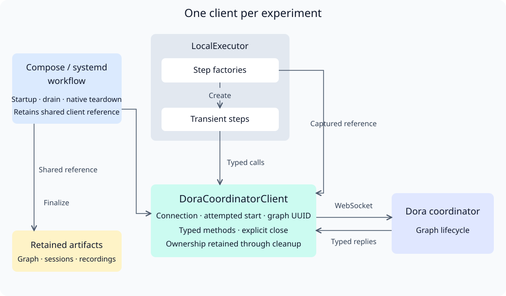

# Dora control migration

Replace short-lived Dora control commands with a shared async Rust client for
Compose and systemd. Keep coordinator and daemon processes under their existing
runtime owners. This PR contains the migration plan and architecture only.

## Existing use and maturity

Compose has used the Dora CLI since commit `2445b07` (2026-10-29).
[`dora.rs`](../../workload-docker/src/workflows/dora.rs) executes readiness and
shutdown commands inside the coordinator container;
[`experiment.rs`](../../workload-docker/src/workflows/experiment.rs) registers,
inspects and stops graph nodes. [PR #199](https://github.com/Cutuy/doramcap/pull/199)
adds control commands as systemd oneshot units.

Dora 1.1.0's CLI uses the same WebSocket protocol proposed here. Its published
[`ControlRequest`](https://github.com/dora-rs/dora/blob/v1.1.0/libraries/message/src/cli_to_coordinator.rs)
and reply types cover version negotiation, daemon readiness, graph startup,
identity, inspection, node stopping and shutdown. The protocol has an existing
upstream consumer; our async adapter would require new qualification.

The exported
[`WsSession`](https://github.com/dora-rs/dora/blob/v1.1.0/binaries/cli/src/ws_client.rs)
is synchronous, owns a Tokio runtime and rejects connection from an async context.
Depending on `dora-cli` also imports its coordinator, daemon and UI dependencies.
Calling the protocol directly must preserve CLI orchestration: graph preparation,
startup completion and stopping dataflows before destroying the runtime.

## Proposed choices for approval

| Choice | Recommendation | Alternative |
| --- | --- | --- |
| Client | Small async adapter using `dora-message = 1.1.0` and `tokio-tungstenite`; both are already in the lockfile | Reuse `dora_cli::WsSession` behind a dedicated thread |
| Ownership | One shared control module used by Compose and systemd; choose its library location before coding | Separate backend adapters |
| Deadlines | Derive control deadlines from existing startup and stop budgets | Add protobuf fields for separate control budgets |
| Readiness | Verify upstream event support; retain an explicitly approved sampling exception if no event exists | Add an upstream readiness subscription first |

Obtain agreement on these choices before implementation. Preserve third-party
JSON at the Dora protocol boundary and use Dora's typed messages directly. Add no
environment configuration. Evaluate authentication and endpoint selection through
explicit inputs, including container versus host paths.

## Milestone 1: Control contract and parity

**Work items**

- [ ] Approve dependencies, module placement, deadlines and readiness behavior.
- [ ] Map `status`, `start`, `list`, `node stop` and `down --force` to typed requests and replies, including the Hello handshake.
- [ ] Preserve descriptor expansion, working directories, frozen graph checks, run identity and session artifacts currently provided by CLI execution.
- [ ] Specify cancellation after a start request is accepted but before its UUID is returned; retain ownership needed for cleanup.

**Validation**

- [ ] Compare the mapping against pinned Dora 1.1.0 CLI source and capture real coordinator exchanges.
- [ ] Demonstrate readiness, registration, inspection and shutdown against the existing CLI behavior.
- [ ] Verify endpoint ownership, authentication behavior and version rejection without adding ambient configuration.

## Milestone 2: Shared async control

**Work items**

- [ ] Implement the approved minimal client with typed requests, response correlation and version checks.
- [ ] Bound operations by their deadlines; wake waiters on disconnect, failure, cancellation and shutdown.
- [ ] Preserve graph identity and attempted operations across cancellation; stop dataflows before runtime teardown.

**Validation**

- [ ] Test actual protocol frames for success, remote errors, mismatched responses and version mismatch.
- [ ] Test a silent peer, disconnect and cancellation during registration and stop; verify no stranded waiters.
- [ ] Test delayed replies and uncertain registration without duplicate graph starts or unrelated graph removal.

## Milestone 3: Migrate both runtimes

**Work items**

- [ ] Replace Compose control exec calls while preserving container path interpretation and graph evidence.
- [ ] Replace #199's systemd control oneshots after reconciling its final merged behavior.
- [ ] Remove unused command helpers, output files and JSON-output parsing once both backends pass qualification.

**Validation**

- [ ] Run Compose and systemd scenarios with a real Dora graph: registration, inspection, node stop, graceful teardown and failed startup.
- [ ] Stop during startup and exercise a hung coordinator; verify resource cleanup, reports and artifact preservation.
- [ ] Verify concurrent repositories remain isolated and control operations launch no short-lived Dora CLI processes.

## Milestone 4: Integration

**Work items**

- [ ] Publish implementation separately and update both runtime documents.
- [ ] Keep migration revertible as a coherent change; remove obsolete CLI-only tests after equivalent protocol coverage passes.

**Validation**

- [ ] Run focused checks, cloud CI and required full local CI on the final implementation revision.
- [ ] Run ARM64 validation; report native Compose/systemd and Dora end-to-end results separately.
- [ ] Record latest evidence and unresolved blockers here before marking milestones complete.

Plan validation (2026-11-07): existing CLI call sites and pinned upstream interfaces
reviewed. Implementation and runtime qualification remain pending.
