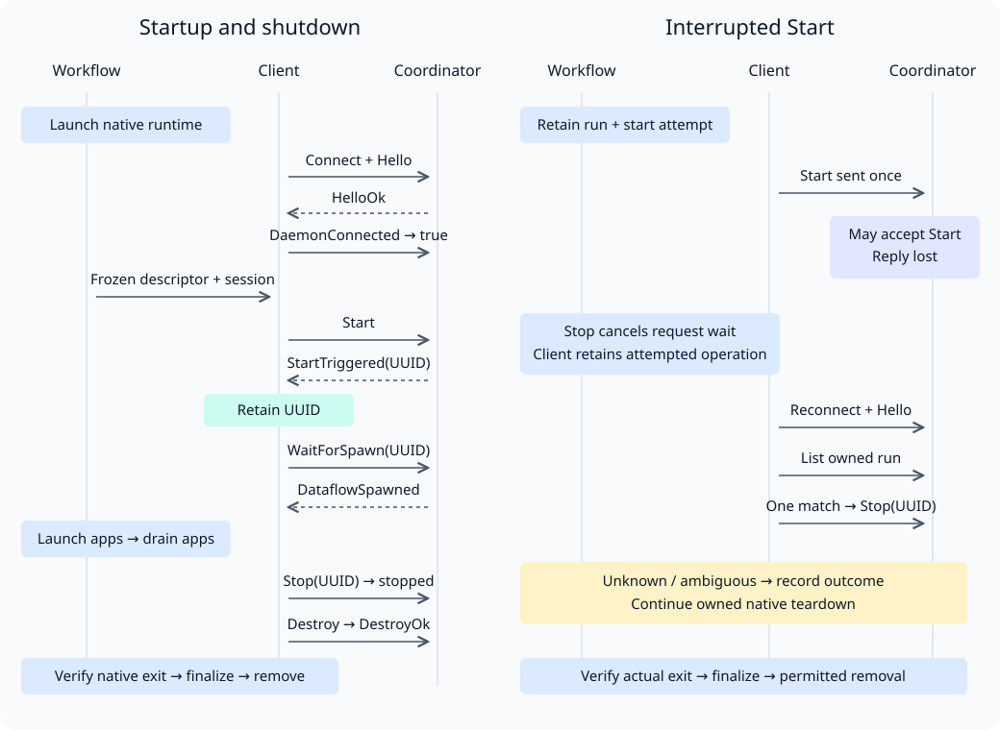

# Dora control migration

Created: 2026-11-07. Design updated: 2026-11-09.

Replace short-lived Dora control commands with `DoraCoordinatorClient`, a shared
async Rust interface used by Compose and systemd. Each experiment retains its own
client through shutdown. Both backends keep native process ownership, application
ordering and evidence handling. Implementation follows the approval gates below.

## Current behavior and reason to change

Compose invokes `dora` through `docker compose exec`; systemd launches a transient
oneshot unit for each control command. Each Dora CLI invocation creates its own
Tokio runtime and WebSocket session, performs the Hello handshake and exits after
its command. One invocation can make several protocol requests. The coordinator,
daemon and dataflow continue independently of that client process.

- Compose: [`dora.rs`](../../workload-docker/src/workflows/dora.rs) controls readiness and shutdown; [`experiment.rs`](../../workload-docker/src/workflows/experiment.rs) owns graph registration and inspection.
- systemd: [PR #199](https://github.com/Cutuy/doramcap/pull/199) merged CLI control; [current control](https://github.com/Cutuy/doramcap/blob/main/libs/workload-systemd/src/dora.rs) and [shutdown](../../workload-systemd/src/running.rs) have since evolved on main.
- Injection: [`register_experiment`](../../workload-docker/src/workflows/steps.rs) already captures a shared experiment dependency in step factories. [`LocalExecutor`](../../orchestrator/src/executor.rs) owns its observer and factories.

The reliability objective is deadline-bounded control, retained cleanup identity
and equivalent behavior across both backends. Current systemd shutdown awaits its
control oneshot without an explicit control deadline. Connection reuse also
removes repeated client processes, handshakes, output files and CLI-output parsing.
The new adapter requires qualification of stale connections and CLI parity.

Dora 1.1.0 publishes typed
[`ControlRequest`](https://github.com/dora-rs/dora/blob/v1.1.0/libraries/message/src/cli_to_coordinator.rs)
and [reply](https://github.com/dora-rs/dora/blob/v1.1.0/libraries/message/src/coordinator_to_cli.rs)
messages. Its exported
[`WsSession`](https://github.com/dora-rs/dora/blob/v1.1.0/binaries/cli/src/ws_client.rs)
is synchronous, owns a Tokio runtime and rejects connection from an async context.
The CLI additionally handles descriptor/session preparation,
[startup completion](https://github.com/dora-rs/dora/blob/v1.1.0/binaries/cli/src/command/start/mod.rs)
and [dataflow stop before runtime destruction](https://github.com/dora-rs/dora/blob/v1.1.0/binaries/cli/src/command/up.rs).
Preserve those behaviors in the migration.

## Accepted design

The user approved these choices in the 2026-11-09 design discussion:

- Name the shared interface `DoraCoordinatorClient`.
- Place its shared implementation in the dedicated `libs/dora-control` crate, separate from node attachment.
- Use `dora-message = 1.1.0` for typed protocol messages and `tokio-tungstenite = 0.29.0` for async transport; reuse the locked versions.
- Derive absolute control deadlines from existing startup and stop budgets. Connect, readiness and graph registration share the startup deadline; shutdown requests share the stop deadline. Startup cancellation gives cleanup a fresh stop budget, and native teardown continues under existing backend stop rules.
- Retain the existing 100 ms startup daemon-registration checks over the reused connection, bounded by the startup deadline; track their event-driven replacement below.
- Reuse one connection within each experiment; retain independent instances for concurrent experiments.
- Inject shared references through existing typed step factories. Steps call client methods; the experiment's lifecycle state also retains a reference for cleanup.

Construct the client before the first start attempt and connect after the backend
launches the runtime. Explicitly finish control shutdown before releasing the
experiment's references. Transient steps and their cancelled futures can end while
the client retains the graph-start attempt and UUID. Native teardown and artifact
finalization remain backend responsibilities.

## Interaction and failure contract

| Phase | Client behavior | Backend responsibility |
| --- | --- | --- |
| Connect | Open the explicit endpoint, perform Hello and verify compatibility | Establish ownership of the coordinator process and endpoint |
| Readiness | Check daemon readiness within the approved startup budget | Observe native process failure and enforce existing app ordering |
| Register | Record the attempt before sending Start; retain its UUID before awaiting spawn completion | Supply frozen descriptor, unique run identity, session facts and runtime-visible paths |
| Observe | Inspect the owned graph through typed requests and replies | Preserve each backend's existing observation policy |
| Stop | Stop applicable system nodes and the owned dataflow before Destroy | Preserve application drain order; verify native process exit |
| Finalize | Close the connection explicitly | Finalize evidence and remove only permitted resources; retain artifacts |

Keep the initial request path serialized through the existing shared-owner
synchronization. Evaluate WebSocket ping/close handling during idle periods before
committing to an additional receive task. Request envelope IDs correlate replies;
the graph UUID identifies the remote dataflow. They have different lifetimes.

Cancellation or a deadline can leave a mutation's remote outcome unknown. Retain
the attempted operation in the client and discard its uncertain connection. Cleanup
may reconnect, repeat Hello and reconcile the exact owned run through List. Stop a
recovered graph only when its identity is unambiguous. Never automatically repeat
Start or other mutations after losing their replies. A missing List entry alone
cannot prove an earlier Start will never take effect.

A failed, disconnected or silent control peer must return a bounded failure to the
backend. The backend continues its owned process teardown, records unresolved
outcomes and verifies actual exit before permitting removal. Closing a socket or
dropping a future does not establish remote graph termination.

## Remaining contract review

The user approved crate placement, dependencies, deadlines and the bounded
readiness polling exception. Review endpoint and
authentication inputs explicitly during parity work. Preserve third-party JSON at
the Dora boundary, use generated configuration and typed Dora messages directly,
and add no environment configuration. An extra worker/task or broader executor
context API requires a demonstrated need and agreement.

Readiness source review: Dora 1.1.0 handles
[`DaemonConnected`](https://github.com/dora-rs/dora/blob/v1.1.0/binaries/coordinator/src/control_requests.rs#L300)
as an immediate boolean query. Its control API exposes log/build-log/topic
subscriptions; no daemon-readiness subscription was found. Compose and systemd
already use named 100 ms startup sampling intervals. These checks establish that
a daemon has registered with the coordinator before Start; a successful Hello
only establishes the coordinator connection. The external control API uses JSON
over WebSocket and supports log/topic streaming. Event-driven daemon readiness
would require an upstream wait-for-daemon operation or subscription. Retain
existing graph observation separately, and await graph spawning through WaitForSpawn.

### TODO: Replace startup readiness polling

- [ ] Add or adopt an upstream wait-for-daemon operation or readiness subscription, then replace both backends' timed daemon-registration checks with an awaited notification.
- [ ] Verify registration before/after subscribing, startup cancellation, disconnect and deadline expiry; remove the 100 ms startup polling constant and exception once both backends pass.

This follow-up is owned by the `dora-control` integration and remains open after
the initial migration. It must preserve the approved startup deadline and teardown behavior.

## Effort estimate

Source-review estimate for one engineer; runtime qualification remains pending.

| Work | Engineer-days |
| --- | ---: |
| Descriptor/session parity and contract mapping | 0.5–1 |
| Async client and protocol tests | 1.5–2.5 |
| Deadlines, cancellation and uncertain-start cleanup | 1–2 |
| Backend migration and CLI helper deletion | 1–1.5 |
| Real-runtime scenarios, CI and ARM64 qualification | 2–4 |
| **Total** | **6–11** |

The coding and focused-test portion is 4–7 days. New upstream subscriptions or
broader graph behavior would require a revised estimate.

## Milestone 1: Agree contracts and establish parity

Evidence (2026-11-09): user approved crate placement, dependencies, deadlines, bounded readiness polling
and the event-driven replacement TODO;
source review confirmed factory
injection, per-invocation CLI connections and the current systemd shutdown wait.
Readiness source inspection found an immediate query and no readiness subscription.
Documentation links, SVG XML, rendered diagrams and whitespace checks passed.
Real protocol captures and endpoint/authentication contract checks are pending.

**Work items**

- [x] Record the approved client name, dedicated crate, per-experiment connection reuse and typed factory injection.
- [x] Validate documentation links, SVG XML, rendered layout and whitespace.
- [x] Approve the locked `dora-message` and `tokio-tungstenite` dependency pair.
- [x] Approve absolute startup/stop control deadlines and a fresh cleanup budget after startup cancellation.
- [x] Approve bounded startup readiness polling and record its event-driven replacement TODO.
- [ ] Specify explicit endpoint/authentication inputs and preserve current runtime execution contexts.
- [ ] Map status, start, list, node stop and down --force to typed exchanges, including Hello and WaitForSpawn.
- [ ] Specify descriptor expansion, frozen graph checks, session artifacts and host/container path interpretation.
- [ ] Specify retained start attempts, UUID persistence, reconciliation and bounded cleanup after cancellation.

**Validation**

- [x] Inspect pinned readiness request handling and subscription types; identify the existing sampling exception.
- [ ] Capture real exchanges against pinned Dora 1.1.0 and compare observable CLI outcomes.
- [ ] Verify version rejection, authentication and endpoint ownership using explicit inputs.
- [ ] Check descriptor/session artifacts and startup completion for the supported graphs of both backends.
- [ ] Verify idle ping/close behavior and the minimal serialized request model.

## Milestone 2: Implement DoraCoordinatorClient

**Work items**

- [ ] Add `libs/dora-control` with typed client operations, serialized request/reply correlation and explicit connection shutdown.
- [ ] Reuse the experiment's connection; preserve intent and graph identity when cancelling a request discards the socket.
- [ ] Bound connect, send and receive by their approved operation deadlines; propagate disconnect, remote failure and cancellation.
- [ ] Reconcile uncertain registration without replaying mutations; stop owned dataflows before Destroy.

**Validation**

- [ ] Exercise real protocol frames for success, remote errors, unexpected reply IDs/types and incompatible versions.
- [ ] Exercise silent peers, idle closure, disconnect, delayed replies and cancellation during Start, WaitForSpawn and Stop.
- [ ] Verify cancellation retains attempted/known graph state and cleanup can acquire the shared client.
- [ ] Verify one connection serves successive operations, independent experiments stay isolated, and completion leaves no blocked waits or extra tasks.

## Milestone 3: Migrate Compose and systemd

**Work items**

- [ ] Reconcile the final implementation with current main, including systemd changes since #199.
- [ ] Inject shared client references through existing factories; keep a reference in backend lifecycle state through cleanup.
- [ ] Replace Compose control exec calls while preserving process ownership, graph evidence and container-visible paths.
- [ ] Replace systemd control oneshots while preserving native unit execution context and teardown order.
- [ ] Remove unused CLI helpers, transient control-unit output files and CLI JSON parsing after equivalent coverage passes.

**Validation**

- [ ] Run each backend with a real graph: readiness, registration, inspection, node stop, failed startup and graceful teardown.
- [ ] Stop during startup before/after Start acceptance and UUID receipt; verify cleanup, reports and artifact retention.
- [ ] Hang/disconnect the coordinator; verify control deadlines allow native teardown and independent exit verification.
- [ ] Verify concurrent repositories remain isolated and control operations launch no short-lived Dora CLI processes.

## Milestone 4: Integrate and qualify

**Work items**

- [ ] Publish implementation separately and update both runtime documents.
- [ ] Keep the migration revertible as a coherent change; remove obsolete CLI-only tests after equivalent coverage passes.
- [ ] Record the latest results and unresolved blockers in the relevant milestone.

**Validation**

- [ ] Run focused checks, cloud CI and required full local CI on the final implementation revision.
- [ ] Run ARM64 validation; report native Compose/systemd, Dora end-to-end and hardware-specific qualification separately.
- [ ] Verify the final implementation preserves the approved ownership, deadline and cancellation contracts.

Planning validation (2026-11-09): relative links, SVG XML, rendered layout and
whitespace passed. Production code is unchanged; runtime tests, CI and ARM64
qualification remain deferred to the implementation milestones.
