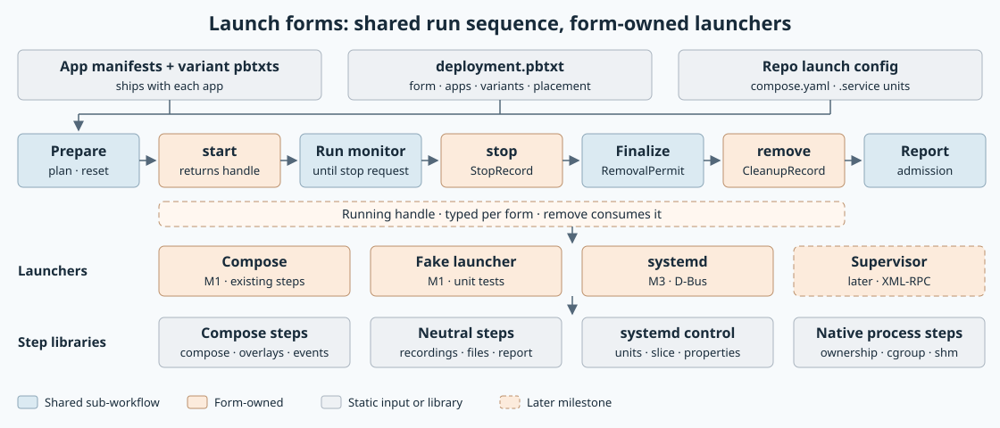
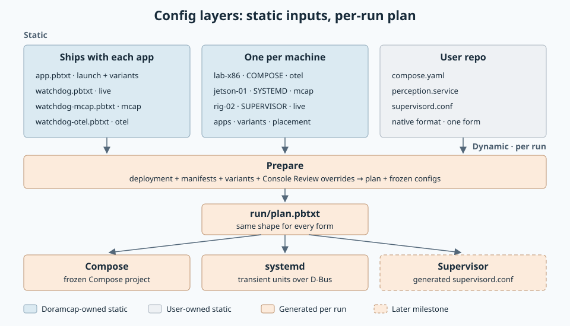
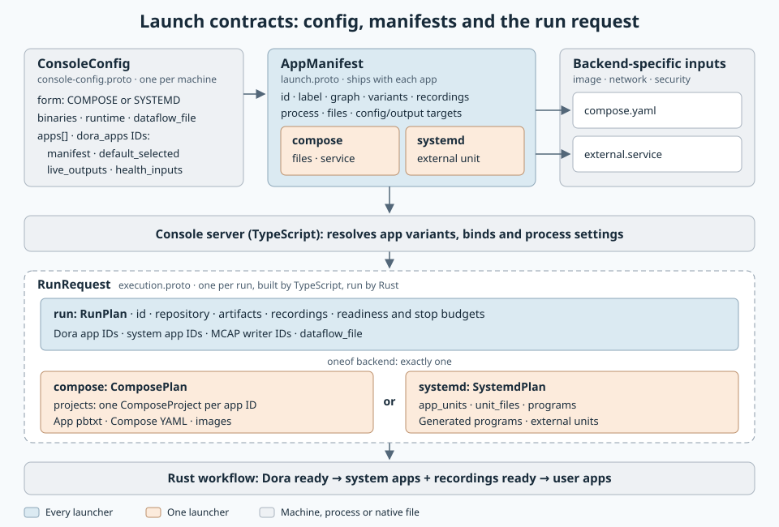
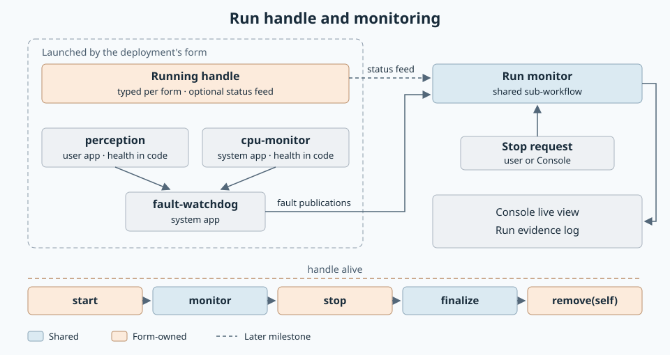
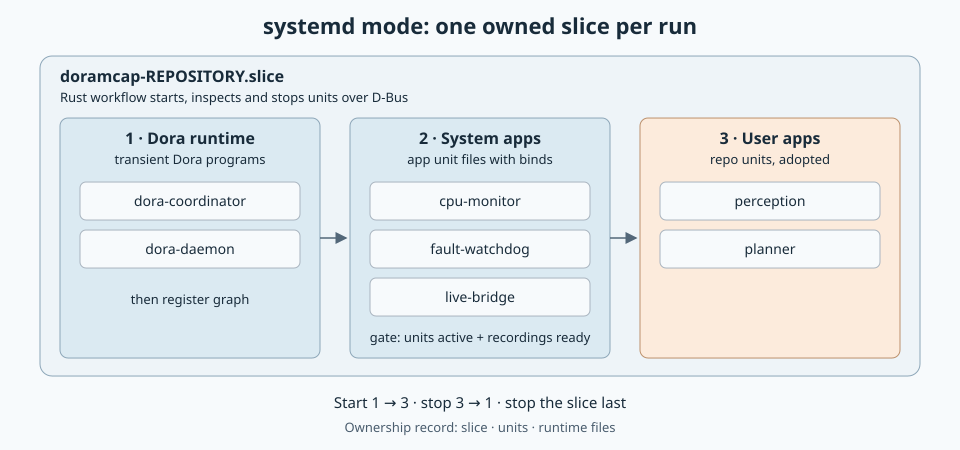

# Launch forms: Compose, systemd and Supervisor

Created: 2026-11-07. Status: Milestones 0–3 implemented; Milestone 4 in progress.

Run an experiment with the launch method its repo uses: Compose, systemd or
Supervisor. Dora, system apps and user apps all launch the same way within a run.
Shared sub-workflows handle preparation, evidence and reporting; each form owns how
its processes start, are watched, stop and are removed.

High-level plan: carry today's Compose runs in a run plan (M0), move Compose onto a
shared run sequence (M1), resolve launches from app manifests and a per-machine
deployment (M2), then add systemd over D-Bus (M3). M0 and M1 change no behavior.
Supervisor and the remaining features follow on demand.

## Accepted design

Agreed with the owner on 2026-11-07.

| Area | Decision |
| --- | --- |
| Forms | Compose, systemd and Supervisor; the deployment picks one form per run. Unit tests use a fake launcher. |
| Apps | Dora, system apps and user apps launch the same way within a form. |
| Reuse | Step libraries grouped by substrate. Code is shared through sub-workflows or individual steps. |
| Sequence | Shared Prepare, Finalize and Report sub-workflows; form-owned start, stop and remove. Phases exchange protobuf records. |
| Handle | `start` returns a typed running handle, even after a failed start. `stop` yields a `StopRecord`; `remove(self)` consumes the handle. |
| Lifecycle authority | Each form's manager: unit state over D-Bus, supervisord events, Docker events. A pidfd is used only by the process's parent. |
| Monitoring | Layer 1: an optional status feed from the handle. Layer 2: Fault Watchdog consumes health that apps publish in code through the reporting library. Neither ends the run. |
| Run end | The run ends on a stop request. A failed unit or app is recorded in the `StopRecord`. |
| systemd leftovers | Admission refuses prior owned resources. Crashes leave units and artifacts intact; `systemd_run --cleanup <repo>` performs explicit cleanup. Compose retains automatic pre-run reset. |
| Service grace | Preserve declared stop grace; seed the runtime copy with `stop_seconds` as the fallback. Native references retain their original values. |
| systemd shutdown | Read effective `TimeoutStopUSec` per unit and add a named reporting margin. Infinite or unreadable timeouts report incomplete shutdown; preserve artifacts and skip finalization. No extra kill. |
| systemd evidence | Result and exit code/status are optional; missing required exit evidence makes the report unsuccessful with a diagnostic. Missing accounting is informational. |
| Adopted references | Preserve native references without rejecting or rewriting them. They retain their host-systemd meaning. |
| Removal | Remove runs only after Finalize issues a `RemovalPermit`. |
| Ordering | Rust enforces fixed phases: Dora ready, then system apps and recordings ready, then user apps. Shutdown reverses the phases. The request carries app roles. |
| systemd control | D-Bus through `zbus` and `zbus_systemd` (approved 2026-11-07). Adoption also writes one runtime drop-in per unit under `/run/systemd/system`. |
| Supervisor control | XML-RPC over the owned daemon's socket, plus an event-listener relay. |
| Resolution | Console resolves deployment, manifests and Review choices in TypeScript, including backend details. It sends Rust one `RunRequest`: the shared `RunPlan` plus a `oneof` holding one backend's plan. Rust performs every system side effect. |
| Principles | Share workflow and step libraries, without interfaces that bridge backend differences. Business, UI and user logic stay in TypeScript; system side effects stay in Rust; they talk over protos. Avoid refactoring existing code unless necessary. |
| Deployment | Console's per-machine config is the deployment: `form`, plus a manifest path and Console settings per app. |
| Contracts | Package `doramcap.launch.v1` in `libs/workload-lifecycle/proto`: manifest, deployment, run plan and phase records. The deployment imports `resource_policy.v1.Policy`. |
| Crates | New `libs/workload-systemd` for the launcher and D-Bus control. Native-process steps (ownership, cgroup, shared memory) are a `workload-lifecycle` module. |
| MVP | Compose and systemd. Supervisor, the live status feed and other items are listed under Future items. |

## Config layers



| Layer | File | Owner | Holds |
| --- | --- | --- | --- |
| Variant config | e.g. `watchdog-mcap.pbtxt`, unchanged | App, own schema | What the app does |
| App manifest | `apps/x/deploy/x.pbtxt` | App | Common process settings, files, variants, recordings, graph, outputs |
| Deployment | `deployment.pbtxt`, one per machine | Operator | Form, apps, default variants, placement, install root, repo config |
| Repo config | `compose.yaml`, `.service`, `supervisord.conf` | User | User apps, in their native format |

Generated per run: Console Review variant overrides, the in-memory `RunPlan`,
frozen config copies and the backend input. The plan has the same shape for every form; only the
backend input differs.



- `AppManifest` may carry both `compose` and `systemd`; the machine's `form` picks one.
- `RunRequest` carries the shared `RunPlan` and exactly one backend plan.
- `RunPlan` owns system-app IDs, MCAP-writer IDs and Dora app IDs and a dataflow artifact.
- Backend plans contain flat launch inputs keyed by app ID. Configurable groups are removed.
- [Shared run fields](110726-shared-run-fields.md) records the implementation and validation.

## Run sequence



```rust
let prepared = prepare(plan, |previous| launcher.reset(previous)).await?;
let (mut running, started) = launcher.start(&prepared).await;
let ended = match started {
    Ok(()) => monitor(&prepared, running.status(), faults, stop).await,
    Err(error) => Some(error),
};
let stopped = running.stop().await;
let permit = finalize(&prepared, &stopped).await;
let cleanup = running.remove(&permit).await;
report(&prepared, ended, &stopped, &cleanup).await
```

`experiment::<F>()` holds this sequence once. One `match` on the deployment's form
selects the launcher.

## systemd mode



Each run owns one slice. The graph accepts only dynamic nodes, so each app is one unit
connected to the Dora daemon. Units share the host `/dev/shm`; units must not set
`PrivateIPC`. Ownership records the run's shared-memory segments for reset.

| Manifest fact | Unit property |
| --- | --- |
| Executable and config argument | `ExecStart=` |
| Dora participant identity | `User=`, `Group=` |
| Memlock | `LimitMEMLOCK=` |
| Placement | `AllowedCPUs=`, scheduler properties from `resource-policy` |
| Stop signal and grace | `KillSignal=`, `TimeoutStopSec=` |
| Capabilities | `AmbientCapabilities=` |
| Readiness | `Type=notify` once the readiness protocol is decided |

## Dependencies for evaluation

| Need | Candidates |
| --- | --- |
| D-Bus client | `zbus`; required for systemd control |
| systemd proxies | `zbus_systemd` generated proxies, or hand-written `zbus` proxies for the few manager and unit calls; `systemd-transient` and `systemd-run` are references |
| Supervisor XML-RPC (later) | Existing `hyper`/`hyperlocal` plus a small codec, or `quick-xml` |

## Milestone 0: Run request for Compose

**Work items**
- [x] Add `doramcap.launch.v1.RunPlan` with the inputs every backend shares.
- [x] Add `ComposePlan` with only Compose inputs; `ComposeRun::from_plan` builds today's launch settings from the run and the Compose plan.
- [x] Console's `RunRequest` now holds the shared `RunPlan` plus a `compose` backend in a `oneof`; the addon accepts it for inspection and start.

**Validation**
- [ ] Mapping test: a run and Compose plan yield today's launch settings.
- [ ] Console server suite and the real Compose Console test.
- [ ] Focused formatting, Clippy and library-boundary checks.

Evidence: pending re-validation after the 2026-11-07 restack around the single run request.

## Milestone 1: Shared run sequence with Compose

**Work items**
- [x] Add `StopRecord`, `RemovalPermit` and `CleanupRecord` to `doramcap.launch.v1`.
- [x] Add `workload_lifecycle::run`: a form-owned `Running` handle (start, ready, ended, stop, remove) and one shared sequence that checks recordings and issues the removal permit.
- [x] Compose runs through it. Its filesystem evidence step keeps `compose.finalize`; the recording check runs as its own step after it.
- [x] Fake-handle unit tests replace the Compose stop-race tests.
- [ ] Share Prepare and Report. Moved to Milestone 4; see decisions below.
- [ ] Record the form in the ownership record. Moved to cross-form reset in Future items.

**Validation**
- [x] Fake-handle tests: a failed start still stops and removes; stop before or during start skips readiness; removal requires stopped writers and durable evidence; recordings are checked only after writers stop.
- [x] Native Compose end-to-end suite and the real Compose Console test.
- [x] Focused Clippy, formatting and library-boundary checks; `workload-docker` unit tests.

Evidence (2026-11-07, x86_64 local):
- Native Compose end-to-end suite: all 12 cases passed.
- Real Compose Console test: three consecutive passes; one earlier failure left no log and did not recur.
- Console server suite: 97 passed, 1 skipped. Lifecycle and `workload-docker` unit tests pass.
- Not run: full CI and ARM64.

### Decisions awaiting owner review

| Topic | Decision | Reason |
| --- | --- | --- |
| Handle shape | One `Running` trait; each form builds its handle. No separate launcher trait. | Start must be cancellable while the handle keeps attempted resources. |
| Prepare and Report | Stay in Compose until Console runs systemd in Milestone 4. | Today's neutral parts are a repository lock and a machine probe; Compose's baseline and report depend on Docker. A copy now would have one caller. |
| Recording check | Its own step after `compose.finalize`, which used to run both concurrently. | The check is shared across forms; Console's timeline shows one more step. |

## Milestone 2: Manifests and deployment

**Work items**
- [x] Add `AppManifest` to `doramcap.launch.v1`: label, graph, Compose launch, recordings and variants.
- [x] Console's config is the per-machine deployment: it gains `form`, and each app may name a `manifest` and keep only Console settings.
- [x] Console expands manifests in TypeScript when it loads a config or resolves a release; the run plan is built from the result.
- [x] Release manifests for CPU monitoring, data recording, Fault Watchdog and the live bridge; the release template uses them.
- [ ] Program launch facts, Dora's manifest and per-app placement. Moved to Milestone 4, their first consumer.
- [ ] Remove inline app definitions. Kept for now so existing configs keep working; inline and manifest apps expand to the same definitions.

**Validation**
- [x] The release manifests expand to exactly the apps of the previous inline release template.
- [x] Manifests reject inline launch fields, paths outside the manifest directory and unsupported forms.
- [x] Console server suite.

Evidence (2026-11-07, x86_64 local): Console server suite 99 passed, 1 skipped, including both tests above. Not run: the release system-app acceptance script, full CI and ARM64. Expansion yields identical app definitions, so Compose launches are unchanged.

## Milestone 3: systemd launcher

Scope agreed 2026-11-07: the library and native tests; Console support is Milestone 4.

**Work items**
- [x] Spike: adopt repo `.service` units unchanged through runtime linking and place them in the run slice. Results below.
- [x] Owner approved `zbus` 6 (`tokio` feature) and `zbus_systemd` (`systemd1` feature).
- [x] New `libs/workload-systemd` with a `SystemdPlan` input: flat transient programs and adopted unit files; shared app roles determine fixed startup phases.
- [x] systemd control steps: subscribe, start transient units, await each start job, adopt units, stop, release references, reset the slice.
- [x] A systemd running handle on the shared run sequence; a failed unit is recorded, and only a stop request ends the run.
- [x] Placement and memlock become unit properties; the report records each unit's result, exit status and accounting.
- [x] Explicit cleanup by repository: stop owned services using their effective timeouts, stop the slice, release units and remove runtime files. Admission never resets automatically.
- [ ] Dora coordinator and daemon units, graph registration and shared-memory ownership. Moved to Milestone 4, where Console resolves Dora's plan.

**Validation**
- [x] Native tests: system apps start before user apps and stop cleanly with an adopted unit; a failing unit is recorded while the run continues; placement and memlock reach the process; abandoned units block admission until explicit cleanup.
- [x] Audit F1–F4: attempted starts remain reportable, peers start before readiness waits, native references are accepted, and cleanup errors propagate.
- [x] Shutdown regressions: declared grace, plan fallback, infinite timeout preservation and optional exit evidence.
- [x] Concurrent repositories with identical service names remain isolated during stop and explicit cleanup; a second run of the same repository is refused.
- [x] Plan validation and strict text decoding unit tests.
- [x] Focused Clippy, formatting and library-boundary checks.
- [x] ARM64 workspace checks (Pueue job 592).

Evidence (2026-11-07):
- Local x86_64/systemd 255: six library tests, all ten native scenarios and the added concurrent-repository scenario pass. Full local CI passes, including default/all-feature workspace tests and Clippy, storage without defaults, formatting, boundaries and snapshot synchronization.
- ARM64: workspace CI passes (Pueue 592). The native systemd executable built, but sudo denied execution; the owner waived that run. GitHub CI compiles these ignored native tests but does not execute them.

Spike results (2026-11-07, systemd 255, x86_64):

| Topic | Finding |
| --- | --- |
| Adoption | Hard-link the repo unit under the run name, `LinkUnitFiles` (runtime), add `/run/systemd/system/<unit>.d/10-slice.conf` with `Slice=`, `Reload`, `StartUnit`. Systemd 255 has no D-Bus call for `Slice=`. |
| Constraints | Repo units already use absolute paths. References retain their original names and host-systemd meaning; they are accepted unchanged. Escape the run ID in slice names; `-` nests slices. |
| End of a unit | Exit is `ActiveState` reaching `inactive` or `failed`; `JobRemoved` marks the start job. Subscribe first and ignore the value from before start. |
| Final accounting | Hold a unit reference (`AddRef` for transient units, `RefUnit` for adopted ones) until the record is written; without one, CPU and peak memory read as unset. |
| Removal | Unref, `StopUnit`, `ResetFailedUnit`, `DisableUnitFiles` (runtime), delete the drop-in and the link, `Reload`, then stop the run slice; slices stay active after their last unit. |
| Crates | `zbus_systemd` covers transient units, adoption, references and result properties. `systemd-transient` and `systemd-run` are too new and cannot adopt units. |

**Validation**
- [ ] Native run of CPU monitoring, Fault Watchdog and one user unit: recordings finalize and the slice is gone after removal.
- [ ] Doramcap killed mid-run: admission preserves leftovers; explicit cleanup removes owned resources.
- [ ] A failing user unit appears in the `StopRecord` and the run continues until stop.
- [ ] Fault Watchdog receives health from a user app under systemd.
- [ ] ARM64 worker run, or a recorded reason it is blocked.

## Milestone 4: Console runs systemd experiments

Decisions (2026-11-07): Dora's coordinator and daemon are units, and its CLI commands run as
oneshot units over D-Bus. Host binaries download on demand from GitHub release assets
published with each release, separate from the Console bundle. Review keeps Compose's level
of detail: app names and profiles. Generated units run in private roots under
`/run/doramcap/<repository>/roots`, seeing host system directories read-only and their
config and output paths through per-unit bind mounts, so app configs keep container paths
and the host tree is never written. A unit is ready once D-Bus reports it running; ready
files are not used. User projects contribute every `*.service` at the project root. Host
binaries come from a `binaries` directory in Console's config until downloads exist.

**Work items**
- [x] Dora under systemd: coordinator and daemon units, daemon readiness, graph registration and `dora down` through oneshot units.
- [x] Generated units run in private roots with per-unit bind mounts.
- [ ] Release workflow publishes per-arch app binaries as release assets; manifests name them with checksums; Console downloads missing ones before Review.
- [x] Manifests state where an app expects its config and outputs, and name its native launch files: Compose files plus the receiving service, and optional external systemd units. Shipped systemd units are generated from common process settings. Common process and file settings live in pbtxt; native files supply backend-specific settings. Console's config gains `binaries` and accepts `form: SYSTEMD`.
- [x] External app unit files are adopted unchanged; a runtime drop-in adds the run's slice, a private root, its binds and `ExecSearchPath` for the binaries directory.
- [x] Console resolves a `SystemdPlan` in TypeScript from the deployment, manifests and Review choices: Dora, then system apps, then every `*.service` at the project root.
- [x] The native addon runs systemd run requests; Console accepts `form: SYSTEMD`. Review shows app variants.
- [x] Coordinator and daemon use app-named pbtxt with common process settings, minimal Compose YAML and generated systemd units.
- [x] Generated and adopted units receive the existing Dora node environment and participant config binding.
- [x] Console without Docker: `SYSTEMD` configurations omit `docker_socket`; Compose connects lazily on its first operation. The release installer still assumes Compose.
- [x] Each run owns its `/dev/shm` directory; generated and adopted units share it, and teardown or explicit cleanup removes it. Admission preserves leftovers; configured `host_shm` entries remain driver-owned.
- [ ] Share Prepare and Report between Compose and systemd.

**Validation**
- [x] Native test: Dora runs as units, registers a dynamic-node graph and stops cleanly with no units left.
- [x] Native test: a unit reads its config and writes results at container paths, and no bind target appears on the host.
- [x] Console unit tests: the release manifests resolve to the expected systemd plan; missing binaries or programs are rejected.
- [x] Rebased native Console run of CPU monitoring and Fault Watchdog (MCAP) beside one user unit: both recordings finalize, removal is clean and no units remain.
- [ ] Rebased shared-memory qualification: units share a run segment, allowed host entries survive, and rejected admission preserves abandoned segments until explicit cleanup.
- [ ] Console killed mid-run: admission preserves leftovers; explicit cleanup removes owned resources.
- [ ] Fault Watchdog receives health from a user app under systemd.

Latest #204 validation passed release/native tests, real systemd and Compose runs, ARM64 worker job 607 and hosted Node CI. Qualification of the #205/#206 rebased stack is pending; Review retains the captured-input admission check.

## Future items

| Item | Notes |
| --- | --- |
| Compose run end | A lost container is recorded instead of ending the run; the run ends on stop, lost observation or the Dora graph stopping. |
| Supervisor launcher | Move `workload-supervisor` onto the shared sequence; XML-RPC; event-listener relay; then delete `recorded_run::Phases`. |
| Live status feed | Layer 1 monitoring for the Console live view. |
| Readiness protocol | `sd_notify` everywhere, or a ready file; decide with the owner. |
| Child-process launcher | Real processes for integration tests; pidfd and `waitid` as parent. |
| Profiler attach | By cgroup or PID, in every form. |
| Native filesystem isolation | Compose keeps OverlayFS; native forms use baseline diffs until then. |
| Cross-form reset | Reset a previous run of a different form from its ownership record. |
| Generated Compose files | Build system-app Compose services from manifests. |
