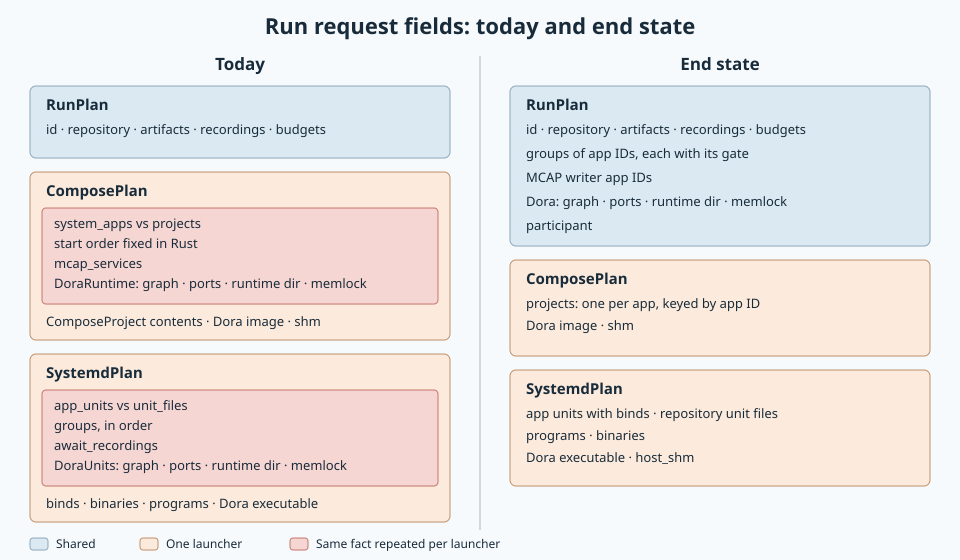

# Run request fields

Created: 2026-11-07. Status: agreed end state; lands after the launch-forms stack and before the
Supervisor backend.

Console sends the native addon one `RunRequest`: the shared `RunPlan` plus one backend part in a
`oneof`. Launcher-neutral facts belong in `RunPlan`; backend parts keep only how each app
launches. Related plan: [launch forms](110726-launch-forms.md).

## Problem

Each backend part redefines the same run facts in its own shape:

| Fact | `ComposePlan` today | `SystemdPlan` today |
| --- | --- | --- |
| Doramcap apps vs user apps | `system_apps` vs `projects` | `app_units` vs `unit_files` |
| Start order | Fixed in Rust: system apps, then projects | `groups`, in order |
| Wait for recording writers | `mcap_services`, by service name | `await_recordings`, per group |
| Dora settings | `DoraRuntime`: graph, ports, runtime directory, memlock | `DoraUnits`: the same five |

- Every shared feature is designed, validated and built by Console once per backend.
- Copies already drift: `host_shm` exists only for systemd; a Dora memlock minimum lived on one side.
- Supervisor would add a third copy of each fact.

**Until this lands:** new launcher-neutral fields go into `RunPlan`, never into a backend part.

## Agreed end state

| Concept | Shared `RunPlan` | Compose part | systemd part |
| --- | --- | --- | --- |
| Run identity and budgets | id, repository, artifacts, recordings, readiness, stop | — | — |
| Start order | Groups of app IDs, each with its gate (wait for recordings) | — | — |
| Apps | — | One `ComposeProject` per app, keyed by app ID, in a plain list | App units with binds (ID = file stem); repository unit files; programs |
| MCAP writers | App IDs | — | — |
| Dora | Graph, coordinator and daemon ports, runtime directory, memlock, participant | Image, shm size | Executable |
| Launch environment | — | — | Binaries directory |
| Host shared memory | — | — | `host_shm`; moves to `RunPlan` once Compose supports it |

The addon matches apps across parts by app ID and maps the request into the existing
`ComposeRun` and `SystemdRunner` inputs, so neither workflow's internals change.

## Milestone 1: Shared run request fields

**Work items**
- [ ] Add groups, MCAP writer apps and shared Dora settings to `RunPlan`.
- [ ] Reduce `ComposePlan` to a plain project list keyed by app ID plus the Dora image and shm size; the addon derives Compose's system/user split and MCAP service names from `RunPlan`.
- [ ] Reduce `SystemdPlan` to app units, repository unit files, programs, the binaries directory, the Dora executable and `host_shm`.
- [ ] Console builds the shared fields once for both backends.

**Validation**
- [ ] Mapping tests: a request yields today's `ComposeRun` and systemd inputs for the release apps.
- [ ] Docker end-to-end suite; real Compose and systemd Console tests; native systemd tests.

## Notes

- Compose MCAP settings apply to every service of a writer app's project. That matches today's
  behavior for all release apps, which each have one service.
- `RunRequest` is not persisted, so the change needs no wire compatibility.
