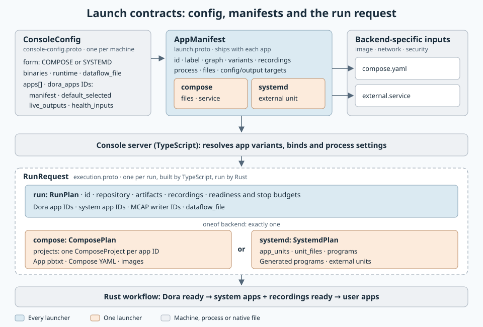

# Shared run fields

Created: 2026-11-07. Implements [PR #207](https://github.com/Cutuy/doramcap/pull/207)
against remote main at #201. Changes are published separately in [PR #211](https://github.com/Cutuy/doramcap/pull/211).

Rust starts Dora apps, then system apps and waits for recordings, then user apps.
Shutdown reverses these fixed phases. App IDs select phases; configurable startup groups are removed.

| Shared `RunPlan` | Backend launch inputs |
| --- | --- |
| Identity, paths, recordings and budgets | Compose projects keyed by app ID |
| Dora, system and MCAP-writer app IDs | systemd programs, unit files and app binds |
| Absolute merged `dataflow_file` artifact | Ordinary app commands, resources, identity and native config files |

Coordinator and daemon are ordinary apps. Their native launch definitions own ports,
images/executables, working directories, mounts and memory limits. Rust retains daemon
readiness, graph registration/identity and graceful shutdown. Control steps derive
the coordinator endpoint and artifact location from the selected apps.
User-provided unit files are loaded by systemd. Workflow-owned CLI oneshots use
explicit arguments, user and artifact binds; native service properties stay in the app unit.

Console declares `apps` and selects the first phase through `dora_apps` IDs.
Compose resolves writer app IDs to every selected service. Protobuf field numbers
may change while these contracts remain in development.

## Milestone 1: Shared contracts and fixed startup

**Work items**
- [x] Share role IDs, recording writers and the dataflow artifact.
- [x] Flatten backend plans; remove configurable groups and recording-gate flags.
- [x] Enforce fixed phases in Rust and share Console's request builder.
- [x] Remove `DoraSettings`, `DoraUnits`, `DoraRuntime` and generated Compose-service schemas.
- [x] Declare Dora through ordinary native app files; migrate Console and Project Explorer.
- [x] Update design documentation and diagrams.

**Validation**
- [x] Affected Rust targets compile and focused launch-library unit tests pass.
- [x] Regenerated Console protobufs pass TypeScript checking.
- [x] Focused Console contract tests pass.
- [x] Focused native systemd Dora startup, graph registration and cleanup pass.
- [ ] Full native Docker/systemd integration on the revised ordinary-app model.
- [ ] Full local/cloud CI and ARM64 validation: resumed; final results pending.
- [ ] Real Console systemd execution: deferred to #204, absent from this base.

## Schema ownership

`launch.proto` owns shared run facts. `compose_plan.proto` contains ordinary projects;
`systemd_plan.proto` contains ordinary programs, unit files, binds and the binaries
path. Native Compose and systemd files carry Dora launch details. `dataflow_file`
names the merged native Dora artifact registered by the Rust workflow.

#204–#207 remain unchanged.
