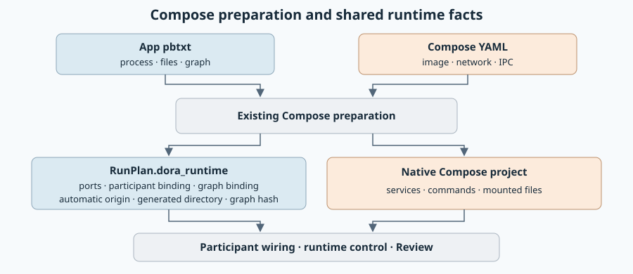

# Shared run fields

Created: 2026-11-07. Implements [PR #207](https://github.com/Cutuy/doramcap/pull/207)
against remote main at #201. Changes are published separately in [PR #211](https://github.com/Cutuy/doramcap/pull/211).

Rust starts Dora apps, then system apps and waits for recordings, then user apps.
Shutdown reverses these fixed phases. App IDs select phases; configurable startup groups are removed.

| Shared `RunPlan` | Backend launch inputs |
| --- | --- |
| Identity, paths, recordings and budgets | Compose projects keyed by app ID |
| Dora, system and MCAP-writer app IDs | systemd programs, unit files and app binds |
| Absolute merged `dataflow_file` input and prepared `dora_runtime` | Ordinary app commands, resources, identity and native config files |

Coordinator and daemon are ordinary apps. App-owned pbtxt supplies their shared commands,
working directories, file bindings, resource limits and shutdown settings. Native files
supply the remaining Docker or systemd settings. Rust retains daemon
readiness, graph registration/identity and graceful shutdown. Compose preparation records resolved endpoints and attachment bindings once in
`RunPlan.dora_runtime`; control steps and participant wiring consume that record.
Systemd adoption of the prepared runtime is tracked with #204.
User-provided unit files are loaded by systemd. Workflow-owned CLI oneshots use
explicit arguments, user and artifact binds; native service properties stay in the app unit.

Console declares `apps` and selects the first phase through `dora_apps` IDs.
Compose resolves writer app IDs to every selected service. Protobuf field numbers
may change while these contracts remain in development.

## Milestone 1: Shared contracts and fixed startup

**Work items**
- [x] Share role IDs, recording writers and the dataflow artifact.
- [x] Flatten backend plans; remove configurable groups and recording-gate flags.
- [x] Enforce fixed phases in Rust and share Console's request builder.
- [x] Remove backend-specific Dora settings and generated Compose-service schemas.
- [x] Declare Dora through ordinary native app files; migrate Console and Project Explorer.
- [x] Update design documentation and diagrams.

**Validation**
- [x] Affected Rust targets compile and focused launch-library unit tests pass.
- [x] Regenerated Console protobufs pass TypeScript checking.
- [x] Focused Console contract tests pass.
- [x] Focused native systemd Dora startup, graph registration and cleanup pass.
- [x] Native systemd suite and real Compose Dora recording/shutdown scenarios pass.
- [ ] Final full CI: local Rust/Node and ARM64 passed the helper restoration; the file-bind correction is rechecking.
- [ ] Real Console systemd execution: deferred to #204, absent from this base.

## Schema ownership

`launch.proto` owns shared run facts. `compose_plan.proto` contains ordinary projects;
`systemd_plan.proto` contains ordinary programs, unit files, binds and the binaries
path. `AppManifest` owns common process and file settings; native inputs hold backend-specific settings. `dataflow_file`
names the merged native Dora artifact registered by the Rust workflow.

#204–#207 remain unchanged.

## Milestone 2: Shared app configuration

**Work items**
- [x] Preserve current protobufs; add common process and file settings.
- [x] Extend existing manifest expansion and backend preparation; reuse existing bridge APIs.
- [x] Share automatic Dora port selection; retain explicit pbtxt ports.
- [x] Use app-named pbtxt and variants; minimize Docker YAML and update gallery consumers.
- [x] Generate shipped systemd units; retain external units separately.

**Validation**
- [x] Common command, limits, files and shutdown settings reach both backend plans; manifest edits change input hashes.
- [x] Selected variants bind the same app config in both backends; systemd-only manifests require no Compose files.
- [x] Native Docker and systemd tests cover startup, explicit/automatic ports, graph registration and cleanup.
- [x] Focused Rust and Console suites, affected-target Clippy, formatting, library boundaries and gallery compilation pass.
- [ ] Hosted CI and ARM64 worker validation of the published revision.

Latest local evidence: Console has one existing root-setup skip; the Docker library has one opt-in test skip. All 16 native systemd cases pass, with an additional generated-app participant check. Docker recording, automatic startup and independent preparation snapshots pass. Console systemd execution remains deferred to #204.

## Milestone 3: Shared prepared Dora runtime

`RunPlan.dora_runtime` is absent in caller inputs and filled by each preparation.
It records resolved ports, whether they were automatic, the generated runtime
directory, participant Zenoh binding and frozen graph binding/hash. Compose keeps
native service names and executables. App pbtxt remains the source configuration.

**Work items**
- [x] Define the shared protobuf runtime and reject caller-supplied resolved values.
- [x] Reuse Compose preparation; finalize bindings against the executed frozen files.
- [x] Consume shared fields in control, participant wiring and Review normalization.
- [x] Preserve independent automatic-port selection, explicit-port identity and plain Compose.

**Validation**
- [x] Focused Rust tests and affected-target Clippy.
- [x] Native Docker tests: recording/shutdown, partial-start cancellation, automatic and explicit ports, frozen participant bindings, independent Review identity and plain Compose.
- [x] Console protobuf generation, TypeScript and native-addon/gallery compilation.
- [ ] Hosted CI and ARM64 worker on the published revision.

Latest local evidence: focused release library and native Docker checks pass;
affected Clippy, formatting and dependency boundaries pass. Native fixture assertions
now follow the shipped coordinator IPC setting and existing host-network warning.
Hosted CI and ARM64 validation remain pending publication. Systemd runtime adoption remains in #204.
