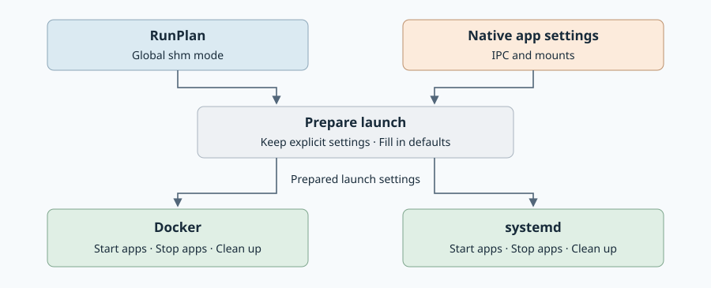

# Shared memory: implementation

Created: 2026-11-08. Implements the [architecture](110826-run-shared-memory.md).
Implementation has not started; the milestones below are pending.

## Where the changes belong

Add `bool host_shared_memory` to the existing protobuf `RunPlan`: false selects
Isolated mode; true selects Host pass-through. Console and direct callers pass
that field through the existing launch path. No new settings message is needed.
Remove any `host_shms` field, adapters or handling encountered during implementation;
none exists in the current source. Native mounts supply selective host access.

Preparation validates native IPC and mount settings against the global mode,
then resolves the effective configuration shared by Review and launch.

| Backend | Main change |
| --- | --- |
| Docker | Attach participating containers to the same run shm and IPC setup, with or without Dora; apply accepted native IPC and bind declarations to the containers. |
| systemd | Mount the same run-private shm filesystem in participating units; apply accepted native unit and bind declarations to those units. |

The original Compose and unit files remain unchanged. Each backend tracks the
mounts and namespaces it creates and releases them through its existing
stop/cleanup flow. Live host shm stays outside filesystem overlays.

## Native settings and the global mode

Resolve native settings before generating mounts. In Isolated mode:

| Explicit native setting | Final setup for that app |
| --- | --- |
| None | Mount run memory at `/dev/shm` |
| One host segment | Keep run memory; bind the host segment at its declared target with its declared permissions |
| Entire host shm, or Docker `ipc: host` | Fail preparation; name the app and setting and require global Host mode |
| Explicit private shm or another IPC arrangement | Apply the explicit setup if compatible with the requested mounts; otherwise fail preparation with the conflicting settings |

In Host mode, the default and whole-host declarations use host shm. Explicit
private settings still apply to the app that declares them. Never silently drop
an IPC or mount declaration or fall back to host access after a conflict.

Resolve native sources from the host before installing the run's private view.
A native target such as
`/input/camera` must still refer to the original host segment.

## Extend the existing experiment snapshots

Use Docker's existing [snapshot capture](../../workload-docker/src/workflows/recorded_compose/preparation/snapshot.rs)
and systemd's [input capture](../../workload-systemd/src/preparation.rs). Retain
host-shm observations in their existing `ConfigurationSnapshot` records for A/B
comparison, alongside the stable configuration fingerprints.

- For each host-shm source, record the resolved source, target, access mode,
  device/inode identity, object type, byte size, owner/group, permissions and
  modification/change timestamps using filesystem metadata calls.
- For directory binds and whole-host mode, enumerate the exposed objects and
  record their metadata, including nested entries. Record capture failures
  explicitly. The observation describes that traversal of a live filesystem.
- Read no shm payload bytes, touch no mapped pages and create no frozen shm copy.
  Cost is O(number of observed entries), independent of total shm byte size.
  Metadata is sufficient; do not compute a payload SHA or claim content equality.
- Keep live observations separate from the configuration identity used by
  Review/Start. Ordinary host writes must not invalidate Review. Changed mount
  declarations or captured configuration still require fresh preparation.

Detect host shm from the resolved host source, including symlinks and alternate
targets. A read-only shm bind stays live through preparation; read-only controls
app writes. Ordinary configuration files retain their existing byte capture.

## Kernel lifetime and run cleanup

Use native kernel object, mount and namespace lifetimes. An app exiting does not
trigger removal of shared run resources while other apps still use them. Track
the run-owned attachments through the existing backend lifecycle and release
them after verified shutdown. Validate restart and crash cleanup with real apps.

## Required evidence

Sharing, conflict errors, permissions, snapshot capture and cleanup must be tested on a
real Docker Engine and a real systemd service manager, using real producer and
consumer processes. Mocks and generated-configuration assertions cannot satisfy
these acceptance checks. Record mount/IPC observations and actual reads/writes;
mark a missing platform check as blocked.

## Milestone 1 — Prove sharing and lifetime

**Work items**

- [ ] Try the smallest native approach on Docker and systemd, with and without Dora.
- [ ] Use native mounts and namespaces shared for the run; connect their cleanup to existing backend recovery.

**Validation**

- [ ] Two apps exchange live data; another run and the host's ordinary shm view cannot see it.
- [ ] A producer exits while another app continues using the shared object; verify native lifetime and eventual run cleanup.
- [ ] Failed startup and controller crashes leave resources that can be cleaned up safely.
- [ ] Check POSIX and System V shared memory separately.

## Milestone 2 — Apply settings consistently

**Work items**

- [ ] Add the single boolean field to `RunPlan` and wire it through existing callers and preparation; remove any remaining `host_shms` support.
- [ ] Keep track of explicit native settings through Compose merges and systemd unit/drop-in loading.
- [ ] Keep host shm live through both backends' preparation, including read-only binds and alternate mount targets.
- [ ] Extend both existing snapshots with host-shm metadata observations; keep Review/Start configuration comparison independent of live data changes.

**Validation**

- [ ] Real launches distinguish missing settings from explicit ones; user/system apps and pbtxt/native inputs behave consistently.
- [ ] A read-only host shm file stays live after preparation and launch, at both its usual path and an alternate target. Host writes are visible; app writes are denied.
- [ ] Live data changes leave Review valid. Changing the mount declaration or captured configuration requires fresh preparation; ordinary configuration capture still works.
- [ ] A/B snapshots contain metadata for selective host binds and whole-host access, including nested objects and explicit capture errors.
- [ ] With a fixed object count and increasing shm byte sizes, capture performs metadata operations without reading payloads; record syscall/IO evidence and timings.

## Milestone 3 — Implement both backends

**Work items**

- [ ] Connect the proven sharing approach to app startup, shutdown and cleanup.
- [ ] Remove unconditional Dora IPC overrides; apply accepted native mounts and reject conflicting IPC/mount settings before launch.

**Validation**

- [ ] In Isolated mode with no override, real apps use the same run memory; host memory remains separate.
- [ ] In Isolated mode with one native host bind, the selected host segment stays live while ordinary shm still belongs to the run. Cover read-only and writable binds, files/directories, symlinks and alternate targets.
- [ ] In Isolated mode, whole-host mounts and Docker `ipc: host` fail preparation before any app starts; diagnostics identify the app, setting and required Host mode.
- [ ] In Host mode, whole-host mounts and Docker `ipc: host` succeed. Files created by host and app after startup are visible to each other; explicit private native settings still apply.
- [ ] Inspect real containers and units to verify accepted IPC and mount settings take effect. Incompatible requirements produce a clear error before launch.
- [ ] Host objects and app writes to them survive cleanup; run-owned memory disappears after verified shutdown. Cover partial startup, cancellation and abandoned runs.

## Milestone 4 — Check complete workloads

**Work items**

- [ ] Add small runnable examples and link them from the docs.
- [ ] Exercise Console, direct callers and Dora on both backends.

**Validation**

- [ ] Focused Rust release/locked checks, Console tests and TypeScript checking pass.
- [ ] Dora exchanges data and finishes recordings in both modes; test native overrides that split apps into different shm groups.
- [ ] Run the [required local CI](../../../AGENTS.md#testing-and-ci) and ARM64 checks at integration. Record native backend and GPU checks separately.

Evidence: documentation checks are recorded in PR #234. All runtime acceptance
checks remain pending; no native test results are claimed.
