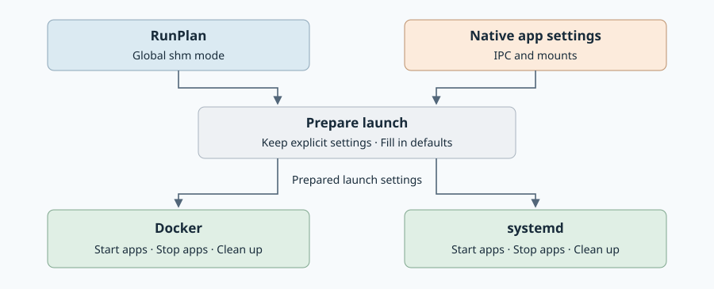

# Shared memory: implementation

Created: 2026-11-08. Implements the [architecture](110826-run-shared-memory.md).
Implementation has not started; the milestones below are pending.

## Where the changes belong

Add one protobuf setting for the global mode. Console and direct callers pass it
through `RunPlan`. Preparation applies explicit native settings first, then fills
in defaults. Review and launch use that same prepared configuration.

| Backend | Main change |
| --- | --- |
| Docker | Share run memory even without Dora. Preserve declared IPC settings and host mounts. |
| systemd | Give the run a shared private shm filesystem. Preserve explicit unit settings. |

Each backend tracks the memory it creates and removes it through its existing
stop/cleanup flow. Live host shm stays outside filesystem overlays.

The open implementation question is **what keeps run memory alive when an app
exits**. Prove this first. Review the approach before adding a helper process or
dependency.

## Milestone 1 — Prove sharing and lifetime

**Work items**

- [ ] Try the smallest native approach on Docker and systemd, with and without Dora.
- [ ] Choose how run memory stays alive and how it is recovered after a crash.

**Validation**

- [ ] Two apps exchange data; another run and the host's ordinary shm view cannot see it.
- [ ] App exit, failed startup and controller crashes leave resources that can be cleaned up safely.
- [ ] Check POSIX and System V shared memory separately.

## Milestone 2 — Apply settings consistently

**Work items**

- [ ] Wire the two global modes through configuration, `RunPlan` and preparation; reject unknown modes.
- [ ] Keep track of explicit native settings through Compose merges and systemd unit/drop-in loading.

**Validation**

- [ ] Missing settings use our default; explicit settings keep their meaning, including read-only mounts.
- [ ] User/system apps and pbtxt/native inputs produce the same behavior for equivalent settings.
- [ ] Review matches launch; changed input files or policy require fresh preparation.

## Milestone 3 — Implement both backends

**Work items**

- [ ] Connect the proven sharing approach to app startup, shutdown and cleanup.
- [ ] Remove unconditional Dora IPC overrides and allow explicit host shm mounts through filesystem preparation.

**Validation**

- [ ] Real containers and units pass default sharing, host mode and selective-mount tests.
- [ ] Host writes remain live and survive cleanup; run-owned memory disappears after verified shutdown.
- [ ] Explicit IPC, mount and capacity settings are preserved. Incompatible requirements produce a clear error.
- [ ] Cleanup handles partial startup, cancellation and abandoned runs without deleting host data.

## Milestone 4 — Check complete workloads

**Work items**

- [ ] Add small runnable examples and link them from the docs.
- [ ] Exercise Console, direct callers and Dora on both backends.

**Validation**

- [ ] Focused Rust release/locked checks, Console tests and TypeScript checking pass.
- [ ] Dora exchanges data and finishes recordings in both modes; test native overrides that split apps into different shm groups.
- [ ] Run the [required local CI](../../../AGENTS.md#testing-and-ci) and ARM64 checks at integration. Record native backend and GPU checks separately.

Evidence: documentation checks pending. Runtime checks wait for implementation.
