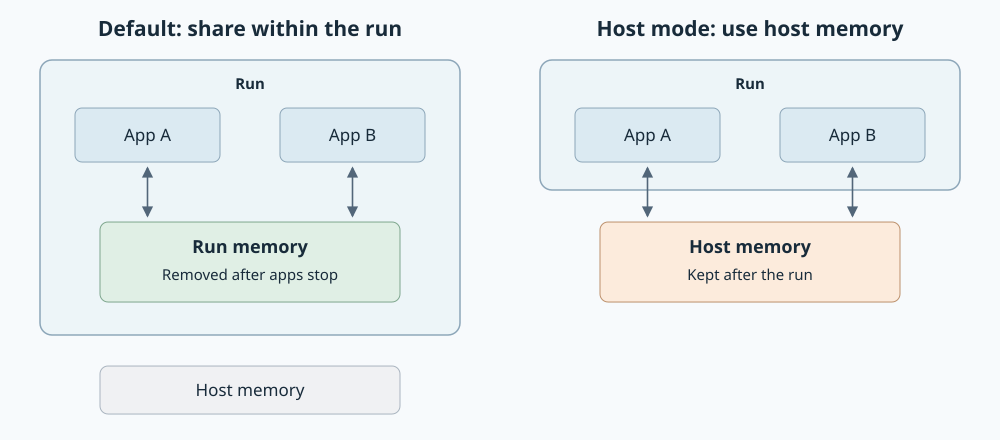

# Run shared-memory policy

Created: 2026-11-08. Status: policy agreed; implementation pending.

Supersedes [PR #206](https://github.com/Cutuy/doramcap/pull/206).
Start from current main; implement the new policy in a fresh PR after this plan.
Planning baseline: `12f29d83`. The plan PR changes documentation only.

## Agreed contract

| Global policy | App view | Cleanup |
| --- | --- | --- |
| Host-invisible (default) | One writable shm filesystem shared by the run's apps; host shm is absent | Remove owned shm after all users stop |
| Host-pass-through | Host shm with its normal access permissions | Preserve host objects |

- Apply the same defaults to user, system and Dora apps, from pbtxt or native inputs.
- Explicit native settings override global policy per container/unit and affected resource or path. Omitted native settings use the global policy.
- A selected native host bind overrides that path; the remaining shm view keeps its policy. Preserve read-only flags and source/target paths.
- An explicit private namespace or whole-shm replacement can separate an app from its peers. Preserve that choice and validate its runtime requirements.
- Offer two global modes. Selective read-only or writable host access uses native mounts. Global host-readonly and the `host_shm` names list are excluded.
- Host-invisible means separate ordinary host/run shm views. Privileged host inspection remains possible.
- Default storage is a private tmpfs visible through run namespaces. Keep live shm outside filesystem OverlayFS/writeback.
- On failed stop or uncertain shutdown, preserve owned resources and report incomplete cleanup. Recovery follows each backend's existing admission/reset contract.

## Resolution and ownership

Use one shared protobuf policy enum, carried by Console configuration into `RunPlan`.
Omission selects host-invisible; reject unknown values before launch. The approved
configuration scope is these two modes; introduce no environment variables.

Each backend resolves native declarations with the global default once during
preparation. Review and execution consume the same result. Preserve explicit
values through Compose merges and applicable systemd unit/drop-in processing;
platform-injected defaults do not become user overrides. Treat the IPC namespace,
the `/dev/shm` filesystem and individual bind targets separately.

The backend owns namespace creation, participant attachment, shutdown and removal.
Every attempted resource enters its ownership record before cancellation is possible.
Qualify POSIX and System V shm separately; a `/dev/shm` bind alone does not establish
IPC-namespace isolation.

## Starting gaps

| Area | Current main | Required change |
| --- | --- | --- |
| [Docker wiring](../../workload-docker/src/workflows/recorded_compose/preparation/model.rs) | Dora preparation replaces app IPC settings | Apply defaults only where native input is absent; support runs without Dora |
| [Docker filesystem preparation](../../workload-docker/src/compose/overlay.rs) | Writable host shm binds meet unsupported-source rejection | Preserve explicit live shm mounts and their access modes |
| [systemd launch](../../workload-systemd/src/running.rs) | No common run-owned shm policy | Share private shm by default; preserve native overrides |
| [Shared contract](../proto/launch.proto) | No global shm mode | Carry the agreed policy consistently through every caller |

## Milestone 0 — Prove the namespace lifecycle

**Work items**

- [x] Record the owner-approved policy and exclusions above.
- [ ] Prototype one shared shm lifetime per backend, including runs without Dora and early participant exit.
- [ ] Demonstrate private mount/IPC ownership for systemd without publishing storage under host `/dev/shm`.
- [ ] Compare reuse of existing backend lifecycle facilities with a dedicated namespace holder. Ask the owner before adding a holder process, dependency or new configuration.

**Validation**

- [ ] Two default apps exchange live shm; a second run and ordinary host shm view cannot see it.
- [ ] POSIX shm and System V shm results identify which filesystem/namespace is shared.
- [ ] Participant exit and controller failure preserve recoverable ownership; final cleanup releases the owned resources.

Evidence: policy agreed in this chat on 2026-11-08. Mechanism probes are pending.

## Milestone 1 — Resolve policy and explicit native overrides

**Work items**

- [ ] Add the two-mode protobuf contract and wire Console, direct launch callers and configuration snapshots.
- [ ] Preserve explicit native IPC and mount choices across merges, drop-ins and generated launch inputs.
- [ ] Resolve defaults per resource/path; use existing native resolution tools and keep backend mechanics in their backend.
- [ ] Report incompatible native/runtime requirements with the app and setting. Preserve explicit input; agree with the owner before adding a transport fallback.

**Validation**

- [ ] Omitted policy selects host-invisible; host mode reaches both backends; invalid modes fail before side effects.
- [ ] An omitted native option differs from an explicitly declared value, including a value equal to the platform default.
- [ ] User/system apps and pbtxt/native inputs resolve identically for equivalent declarations.
- [ ] Per-entry read-only/read-write overrides, whole-shm mounts and IPC overrides retain their scope and precedence.
- [ ] Review matches launch; changes to policy or captured native inputs invalidate the prepared snapshot.

Evidence: pending implementation.

## Milestone 2 — Docker execution

**Work items**

- [ ] Apply the resolved shm/IPC topology with Docker-native primitives; sharing works with and without Dora.
- [ ] Preserve native host binds through filesystem preparation, including alternate targets and whole-shm mounts.
- [ ] Remove unconditional Dora IPC rewriting; keep declared shm capacity/access settings or report a concrete incompatibility.
- [ ] Keep namespace lifetime independent of one app's successful startup; release only owned resources after stop.

**Validation**

- [ ] Real containers share default shm across app roles; simultaneous runs stay separate.
- [ ] Host mode supports live writes in both directions; host objects and app writes survive run cleanup.
- [ ] Selected host mounts obey native access modes while the remaining default shm stays private.
- [ ] Explicit private/shared/host IPC and whole-shm mounts retain their behavior; ordinary filesystem overlays still work.
- [ ] Partial startup, cancellation, participant exit and reset leave no falsely successful cleanup or foreign deletion.

Evidence: pending implementation; native Docker tests require a local engine.

## Milestone 3 — systemd execution

**Work items**

- [ ] Attach generated programs, adopted project units and app units to the proven run namespace lifecycle.
- [ ] Apply default bindings only where native declarations leave room; preserve applicable unit/drop-in semantics.
- [ ] Implement host mode with host-owned storage; keep native read-only and per-path overrides.
- [ ] Extend existing ownership/admission/cleanup records through failed start, controller crash and explicit reset.

**Validation**

- [ ] All three unit forms exchange default shm; host and another run cannot access it through their ordinary shm views.
- [ ] Host mode and selective native binds demonstrate live reads/writes and host-object survival after cleanup.
- [ ] Native isolation, mount and access overrides retain their scope; generated defaults cannot silently replace them.
- [ ] Abandoned units remain recoverable; cleanup removes only owned mounts/namespaces after verified shutdown.

Evidence: pending implementation; native systemd tests require root and a system service manager.

## Milestone 4 — Integration and qualification

**Work items**

- [ ] Add small runnable examples for both global modes and native selective access; keep docs focused on policy and links.
- [ ] Exercise packaged Console, direct launch callers, user/system apps and Dora under both backends.
- [ ] Audit final implementation against the design and implementation guides; keep current evidence in these milestones.

**Validation**

- [ ] Focused release/locked Rust checks, Console tests and strict TypeScript checking pass.
- [ ] Real Dora exchange and finalized recordings work with default sharing and host mode; explicitly split native configurations have verified behavior.
- [ ] Full local CI at integration covers the required boundaries, formatting, default/all-feature Clippy/tests, storage and snapshot checks.
- [ ] ARM64 worker validation completes; record native backend capabilities separately from workspace tests.
- [ ] Report CUDA/GPU/IPC qualification separately when affected; list skipped/blocked checks without claiming target support.

Evidence: implementation pending. Plan structure, local links, SVG XML/render and
design-guide review pass. Runtime tests, full CI and ARM64 are deferred until implementation.

## Design review

[Design guide](../../../docs/design-guide.md) and
[implementation guide](../../../docs/impl-guide.md) were read at the planning baseline.

| Principles | Application |
| --- | --- |
| D-01–D-04 | Agreed behavior; two global modes; shared policy with backend ownership; explicit native precedence |
| D-05, D-09 | Protobuf contract; approved configuration scope; one prepared result for Review and execution |
| D-06–D-08, D-10, D-12 | Resource lifetime through failure/recovery; verified cleanup; native lifecycle events |
| D-11, D-13 | Preserve capacity declarations; qualify live exchange, real platforms and cleanup |
| I-03–I-07, I-09 | Update callers/contracts together; validate before effects; event-driven lifecycle; observable tests; concise API docs |

Remaining design gate: prove namespace lifetime and review any added holder mechanism in Milestone 0.
