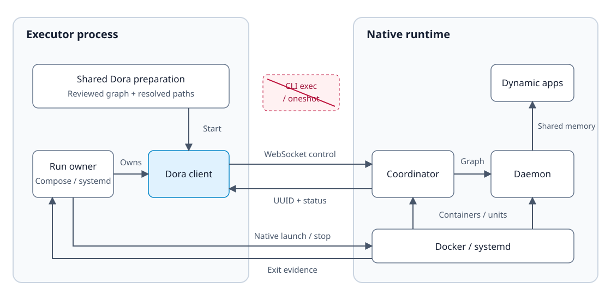
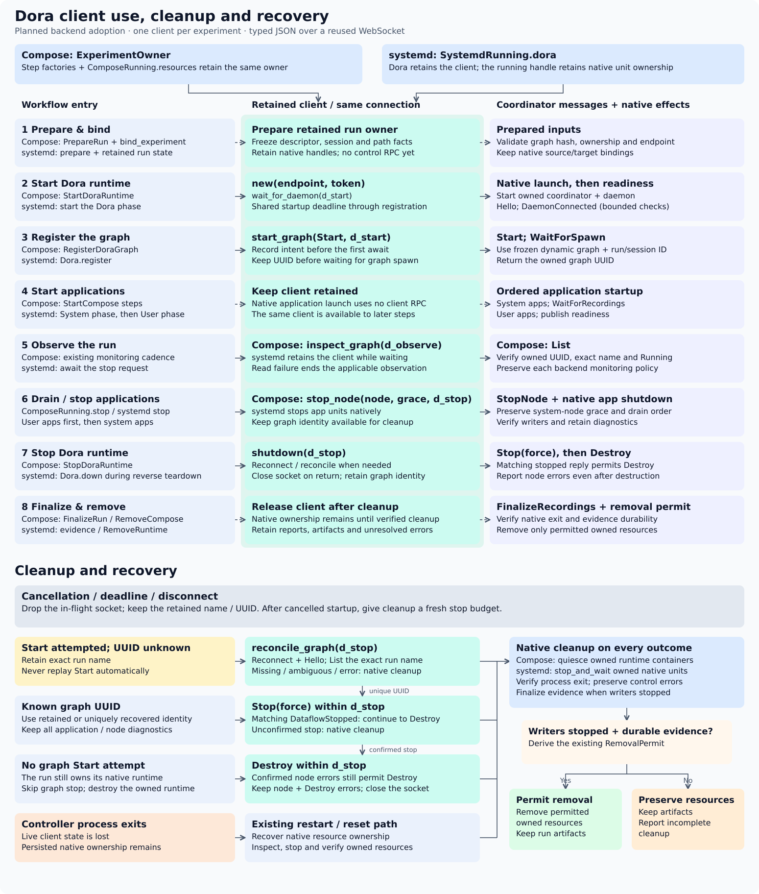

# Dora control integration

Created: 2026-11-09. Updated: 2026-11-10. [Implementation plan](110926-dora-control-integration-impl.md).

The executor controls each experiment's Dora coordinator directly through the
client from [PR #251](https://github.com/Cutuy/doramcap/pull/251). Compose and
systemd continue to launch, stop and verify native services. Their transient CLI
control processes disappear. Adoption ships in separate backend PRs.

## Responsibilities

Shared Dora preparation owns the mapping from the reviewed dynamic graph to a
start request. Both backends use that mapping. Each backend supplies its resolved
filesystem paths and native launch context, and preserves the frozen graph,
session artifacts and shared-memory attachment.

The backend run owner retains one client from before the first start attempt
through cleanup. The client alone owns live graph identity and the connection;
the backend owns native resources, evidence and removal permission. Workflow
steps borrow the retained client. Reports capture observations without becoming
another source of live identity.

## Deployment and access

The executor connects to the resolved coordinator port in the host network.
Compose's Dora services already use host networking. systemd programs and supplied
units must expose their coordinator in that same network; isolated namespaces
fail access validation before graph start.

When authentication is enabled, the backend reads the coordinator's run-local
credential through its resolved runtime directory and passes it explicitly to the
client. Missing, unreadable or mismatched credentials fail before graph start.
Users, binds and permissions stay native. This adoption adds no environment
settings, credential store or privilege changes. The supported access contract
and its acceptance checks are detailed in the implementation plan.

## Failure and restart

Startup and cleanup each have a bounded budget. Cancellation drops the connection
while the retained client keeps the attempted run name and any confirmed graph
identity. Live cleanup can reconnect and reconcile an uncertain start using one
exact name match. Missing or ambiguous identity remains unknown; mutations are
never replayed automatically.

Application drain precedes graph and runtime shutdown. Control failures preserve
diagnostics and still lead to native teardown. Removal requires independently
verified native exit and the backend's existing evidence policy. Protocol replies
and socket closure alone cannot authorize removal.

After controller exit, live client identity is lost. Recovery resets the owned
native runtime under repository admission before admitting another run. Compose
uses its repository reset; systemd uses explicit cleanup. An uncertain old graph
is stopped with its owned coordinator and daemon, and its execution outcome stays
unknown. Artifacts survive reset; unverified exit keeps recovery blocked. The plan
adds no graph resumption or recovery journal.

## Scope and tradeoffs

Both backends retain the supported externally launched dynamic-node workflow,
native service semantics and application drain order. Arbitrary graph builds and
new access mechanisms need separate design decisions. Shared preparation removes
duplicate CLI mapping; native teardown supplies crash recovery without persisting
transport state. Runtime qualification remains pending in the adoption PRs.
