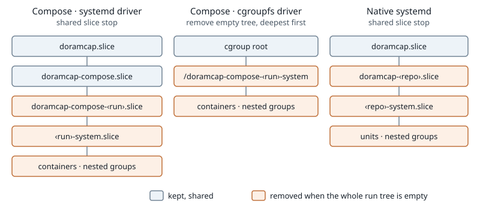

# System-app cgroup

Created: 2026-11-09. [Implementation](110926-system-app-cgroup-impl.md).

Each experiment has one accounting boundary for its system apps, including Dora and
the shared-memory holder. Nested cgroups count toward its CPU and memory.

`workload_lifecycle::cgroup::SystemAppsCgroups` owns the shared step: kernel identity
(host path and ID), accounting checks, host PID membership, the `system-app-cgroup.pb`
artifact and cleanup verification. Backends only allocate and remove.

| Backend | Allocation | Removal |
| --- | --- | --- |
| Docker Compose | Docker creates `cgroup_parent` with its cgroupfs or systemd driver | Empty run tree or both run slices |
| Native systemd | Run slices from the service manager | Both run slices |
| Supervisor | Filesystem group with an ownership ledger | Its own group |

## Cleanup

- Runs after writers stop and evidence is final.
- Nothing is removed while any process remains anywhere in the run tree.
- Compose and native systemd share `cgroup::slice::stop`: stop the slice, confirm the job, wait for unload.
- Compose cleanup stays within the run's stop budget; failures show in the run report.
- Systemd removal needs the local system bus and permission to stop the run's slices.

Requires cgroup v2 CPU and memory accounting. Monitor collectors are separate work.
