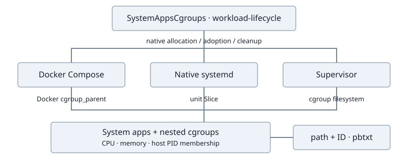

# System-app cgroup

Created: 2026-11-09. [Implementation](110926-system-app-cgroup-impl.md).

Each experiment owns a system-app cgroup. Dora and system apps launch directly
beneath it; nested app groups retain their native accounting. Compose selects the
parent with `cgroup_parent`; systemd selects it with `Slice=`. Existing system/user
app inputs select placement.

Both workflows need the host system service manager. Compose uses a local rootful
Docker daemon with cgroup v2 and the systemd driver. User-app placement follows its
native launch input.

The launchers create the slice before system apps start and verify placement before
user startup. A creation or placement failure aborts startup through existing
shutdown and cleanup. A typed artifact records the host cgroup path and kernel ID.

Systemd owns the slice hierarchy. Backend launchers stop their apps and preserve
evidence before the empty slices are removed. Compose retains automatic recovery;
native runs retain explicit cleanup. Their ownership names are separate.

Monitor collectors and telemetry extensions remain separate work. Native tests
read kernel counters to validate aggregation.
