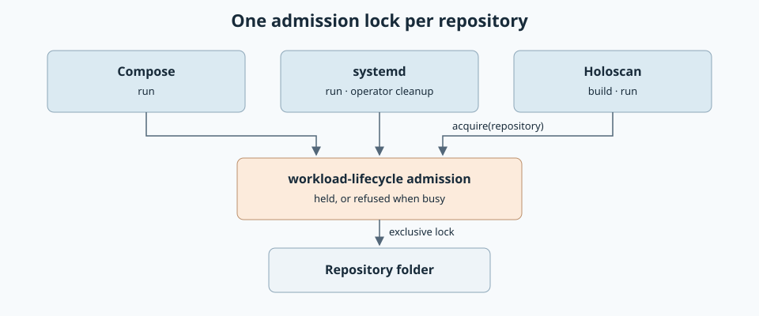

# Shared admission lock

Created November 10, 2026. Status: architecture agreed.
[Implementation plan](111026-admission-lock-impl.md).

One repository hosts one run, build or cleanup at a time. Every workflow asks the
same lock, so a second caller is refused whichever workflow it uses.

## Today

| Workflow | Lock | Location |
| --- | --- | --- |
| Compose | Its own, in `workload-docker` | A lock file in a per-user folder under `/tmp` |
| systemd | Its own, in `workload-systemd` | A lock file under `/run/doramcap` |

Both key on the repository root. They use different files, so a Compose run and a
systemd run on one repository do not see each other. Console's server allows one
run at a time, which hides this in the app. Other callers of the libraries are
not covered.

## Expected behavior

- A run, a Holoscan build and systemd's operator cleanup each take the lock for
  their repository before any side effect.
- A second caller for the same repository is refused at once with a clear message.
  It never waits.
- Two repositories never block each other.
- The lock is released when its holder finishes or dies.
- Two paths that name the same folder share one lock.

## Components

| Owner | Responsibility |
| --- | --- |
| `workload-lifecycle` | The lock: acquire for a repository, refuse when busy, release on drop. |
| Compose, systemd, Holoscan | Take the lock first. Keep their own cleanup and their own behavior after a crash. |

## Key choices

| Choice | Decision | Reason |
| --- | --- | --- |
| Where the lock lives | On the repository folder itself | No lock file, no path naming and no per-user folder. Works for any user who can read the repository, and excludes across users. |
| Passing the lock to child processes | Off by default; Compose turns it on | Compose keeps its lock while its short helper commands finish after a crash. A Holoscan CLI lives as long as the run, so inheriting would block recovery. |
| Behavior after a crash | Unchanged per workflow | Compose resets leftovers before the next run. systemd refuses until an operator cleans up. |

The lock is held in the kernel on the open folder. It writes nothing to disk, so
Git sees no change and Git commands work while it is held.

## Outside this change

- Leftovers from one workflow blocking or confusing another. The lock is free
  after a crash, and each workflow cleans only its own resources.
- Console's own one-run rule.
- `workload-supervisor`. It takes no repository and has no callers outside its tests.

Applicable rules: D-01, D-02, D-03, D-06, D-12 and D-13 in the
[design guide](../../../docs/design-guide.md).
