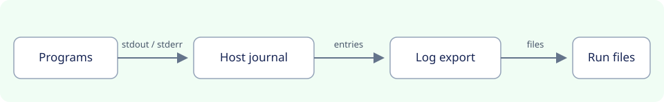

# Application logs for a run

Created November 10, 2026. Updated November 11, 2026. Compose journal driver implemented in #314; log dump deferred until #316 milestone 4.

**Selected: option A, keep the host journal as configured.** Capture is best
effort under the host's existing rate limits and retention. Console leaves those
settings unchanged. The [options record](111126-run-log-capture-options.md)
records the choice; the [implementation plan](111026-run-logs-impl.md) tracks
completed work and the deferred dump.

Console does not keep application output with a run today. This PR sends Compose
output to the host journal by default. A later change will dump each run's output
into the run's files after
[Cutuy/doramcap#316 milestone 4](https://github.com/Cutuy/doramcap/pull/316) provides
keep-with-the-run storage.

## Today

| Workflow | Where application output goes | After the run | What Console reads |
| --- | --- | --- | --- |
| systemd | The host journal, by systemd's default. | Stays in the journal under the unit's name while the host keeps it. | Nothing. A unit's exit reports result, exit code, CPU and memory. |
| Compose | The host journal by default; explicit project logging is preserved. | Journal entries survive container removal while the host keeps them. | The last 20 lines of a failed container through Docker’s logs API, for the error message. |
| Holoscan (planned) | Agreed: the host journal. | Stays in the journal. | The last lines of a failed container. |

## Agreed direction

- Application output from every workflow goes to the host journal.
- Capture uses the host's existing journal policy. Rate limiting can drop entries,
  including quiet-container output when another container shares Docker's limit.
  Retention can remove entries before export. A saved dump contains the entries
  still available and does not establish complete application output.
- Containers use Docker's journal log driver. Holoscan sets it as a launch option.
  Compose sets it in the frozen manifest shared by inspection and launch.
- The user's choice wins. An explicit `logging` block stays intact, including its
  options, an options-only block or an empty block. Those services retain Docker’s
  native behavior. Review shows that logging is configured by the project and
  Console will not collect its logs. The later log dump will skip these containers.
- Console's per-container setting takes precedence over a host-wide Docker default.
- An application that writes its own log files is unaffected. Those files appear
  in the file-change report when they land in a captured folder.

## Planned work

| Item | Description |
| --- | --- |
| Compose through the journal | Implemented in #314: set `journald` for services without a `logging` block; record the default in resolution policy changes. |
| Log dump | Deferred until #316 milestone 4: export each program's available journal entries into a run-owned output folder after the run. |
| Web app | Show the dumped logs with the run's other files. |

The planned dump will be a set of ordinary run files. The file-change report will
list it and the run folder will keep it. Once saved, the dump follows run-file
retention. Console will export all matching entries still available from the
journal and select no snippets. It cannot recover entries already dropped or
removed by the host.

## Later log dump

Implementation depends on #316 milestone 4. The decisions below describe the
agreed follow-up.

At the end of a run, after every program has stopped, Console exports each
program's available journal entries into ordinary run files. Workflows identify
their programs and order finalization; the host journal owns capture and its
limits. Run storage owns the saved files and their retention. Project-managed
logging remains excluded. The [implementation plan](111026-run-logs-impl.md)
records identity scoping, file format and deferred validation.

Confirmed on one host with systemd 255: entries carry the invocation ID and the
service manager reports a unit's current one. The real Compose test also confirms
that `journald` captures stdout and stderr, Docker's failure-output reader works,
and entries remain queryable by full container ID after container removal.
Explicit `json-file` logging and its options remain intact.

## Journal load qualification

Measured November 11, 2026 on x86_64, Docker 29.9.1, Compose 5.6.0 and systemd
255, using the existing host journal settings: a 30-second rate interval and a
10,000-message burst setting. No host settings were changed. Each case used new
containers and started after the default rate window had elapsed.

The opt-in `journald` test runs two Compose services through the frozen manifest.
Both emit numbered stdout and stderr. The quiet service emits 40 lines per
stream during the noisy workload and 20 more after the noisy container exits.
After container removal and journal synchronization, the test counts distinct
messages by full container ID and checks for duplicate or invalid sequences.
The effective burst allowance also depends on the journal's available space;
the configured 10,000-message setting is not a fixed throughput guarantee.

| Case | Noisy lines sent per stream | Noisy stdout / stderr retained | Quiet stdout / stderr retained, out of 60 each |
| --- | ---: | ---: | ---: |
| Low rate, about 2.2 seconds | 200 | 200 / 200 | 60 / 60 |
| Burst, about 0.18 seconds | 4,000 | 4,000 / 4,000 | 60 / 60 |
| Saturation, about 2.1 seconds | 120,000 | 9,993 / 9,995 | 5 / 5 |

Both containers' journal entries name `docker.service` and the same Docker daemon
PID as their writer. At saturation, all 20 quiet markers per stream emitted
after the noisy container exited were missing. The shared rate limit can discard
one container's output because another container is noisy. These are measurements
on one host, not a general supported throughput limit.

A repeat retained 14 of 60 quiet lines per stream at saturation; again, all 20
quiet markers per stream after the noisy exit were missing. An isolated Docker
daemon with both `LogRateLimitIntervalSec=0` and `LogRateLimitBurst=0` also lost
output: 22,484 noisy stdout lines, 22,486 noisy stderr lines and 14 quiet lines
per stream survived. Its temporary unit, socket and data directory were removed.
The live Docker service and host configuration were unchanged.

After rebasing onto main's Compose crate extraction, the relocated qualification
passed low-rate and burst checks again. Saturation retained 14,976 noisy stdout
lines, 14,978 noisy stderr lines and 22/60 quiet lines per stream; all quiet
markers after the noisy exit were missing. Both Docker/journal tests passed as
measurements. See the [current validation record](111026-run-logs-impl.md#milestone-1--compose-routing-and-review).

On systemd 255, zero per-unit values are not exported to journald, which retains
its global defaults. See the
[systemd implementation](https://github.com/systemd/systemd/blob/v255/src/core/unit.c#L5258-L5306).
Disabling the journal's default rate limit uses `RateLimitIntervalSec=0` in
`journald.conf` or a drop-in, as described in the
[journal configuration reference](https://www.freedesktop.org/software/systemd/man/255/journald.conf.html#RateLimitIntervalSec=).
That setting changes the host-wide default; explicit per-unit overrides can
still apply their own limits.

The test reports saturation loss explicitly; a passing measurement test does not
establish complete log capture. Option A accepts the host's existing policy and
the measured shared-loss limitation. The per-unit zero override did not remove
throttling on the supported systemd version. The later dump cannot recover
entries that the journal already dropped, and host retention still bounds what
survives until that dump.

## Open questions

- A process that exits almost at once can lose its identity in the journal, so
  its last lines may be missing from the dump. Measure how often this occurs.
