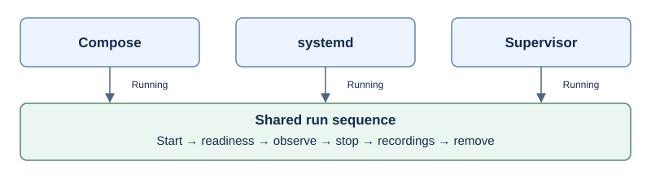

# Retire Supervisor's legacy run driver

Created: 2026-11-10. [Implementation plan](111026-supervisor-run-driver-impl.md).

Compose and systemd use `run::Running`; Supervisor alone uses `recorded_run::Phases`.
Move Supervisor onto the shared sequence and delete the legacy driver once its
callers and behavior tests have migrated. This follows the review of
[PR #252](https://github.com/Cutuy/doramcap/pull/252).

The shared driver owns sequencing: start, readiness, observation, stop, recording
checks and removal. Supervisor owns its daemon, monitor, durable ownership ledger,
process-exit notifications and cleanup evidence. Its existing observed backend
steps remain the machine-operation boundary.

| Contract | Behavior to preserve |
| --- | --- |
| Startup and stop | Partial startup remains owned; cooperative stop awaits teardown; stop before launch suppresses readiness. |
| Readiness | A closed readiness receiver ends execution and triggers teardown. |
| Observation | Either daemon or monitor exit ends the recording attempt through pidfd notifications. |
| Recordings | Forced shutdown cannot establish recording success, even after writers stop. |
| Outcomes | Execution, recording validity and verified cleanup remain independent. |
| Ownership | Dropping a run keeps admission blocked; cleanup retains identity checks and the durable ledger. |

The recording-policy boundary needs agreement before implementation: the current
shared driver checks recordings whenever writers stopped; Supervisor has an
additional launch/forced-shutdown guard. Keep this policy explicit without
misreporting stopped writers. Preserve the current `MonitorRun` and `RunReport`
contracts and app placement.

Limit the migration to the driver and its callers. Transport changes, monitor
collectors and new metrics remain separate work.
