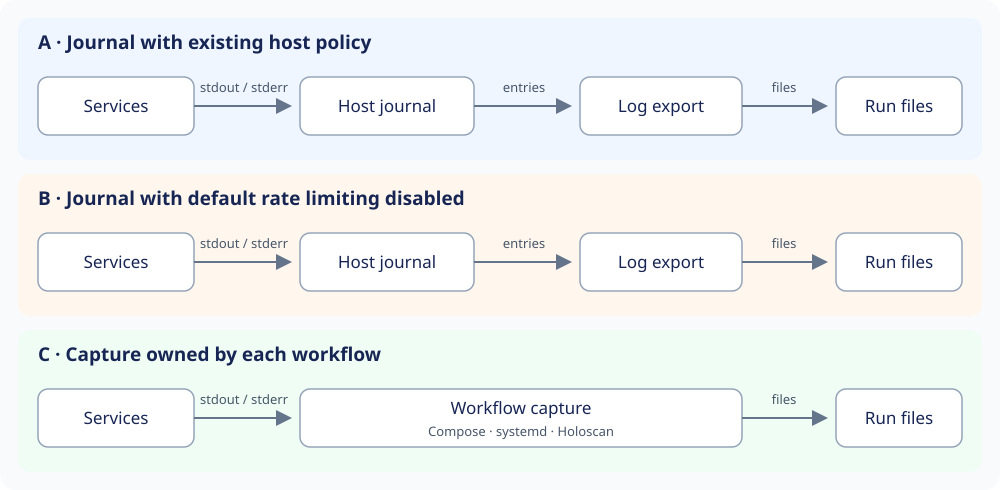

# Run log capture: architecture options

Created November 11, 2026. Updated November 11, 2026. **Selected: option A.**

The host journal owns capture under its existing policy. Console will later
export surviving entries into run files. The user selected best-effort journal
output and accepted the measured shared-loss limitation. Installer and host
settings stay unchanged.

See the selected [architecture](111026-run-logs.md) and the separate
[implementation plan](111026-run-logs-impl.md). The alternatives below record the
tradeoffs considered before the choice.

## Behavior to preserve

- Preserve explicit project logging, including empty blocks. Review identifies
  project-managed logs and their exclusion from Console collection.
- Associate captured stdout and stderr with one run and one program.
- Keep logs with the run's files once #316 milestone 4 provides that storage.
- Preserve available output on failure and finish capture before deleting its
  source. Report capture and storage failures separately from program failure.

The selected contract is to export output still available from the host journal.
Rate limiting and retention may remove entries before that export. Complete
application output is not established by successful export.

## Measured facts

The default journal path retained all sampled low-rate and burst messages. Under
saturation, a quiet container retained 5/60 lines per stream in one run and 14/60
in a repeat. All quiet markers after the noisy exit were missing in both runs.
Both containers' entries identify the same Docker service and writer.

On the tested systemd 255 host, per-service zero rate-limit values inherited the
global defaults. An isolated Docker daemon confirmed that this setting still
lost output. Disabling the journal's default rate limit changes host policy.
The [qualification record](111026-run-logs.md#journal-load-qualification) contains
counts, platform versions and primary source links.

## Options

| Option | Capture behavior | Host changes | Main tradeoff |
| --- | --- | --- | --- |
| **A. Keep the host journal as configured — selected** | Export entries that survive rate limits and retention. | None. | Smallest change; a noisy container can cost other containers their output. |
| **B. Disable the journal's default rate limit** | Keep the existing journal/export architecture and remove default rate suppression. | A journal configuration change affecting the host; explicit per-unit limits still apply. | Small code change with broad operational scope. Retention and storage failures remain. |
| **C. Let each workflow capture into run files** | Capture application output through native Docker and systemd facilities, then retain it with the run. | None required for journal policy. | More lifecycle work: start capture, drain it, handle storage failure and recover before cleanup. |

A and B retain the previously agreed journal architecture. C changes that
decision and needs a separate implementation plan. For C, Docker supports
[following container stdout/stderr](https://docs.docker.com/reference/cli/docker/container/logs/),
and systemd supports
[file destinations for service output](https://www.freedesktop.org/software/systemd/man/255/systemd.exec.html#StandardOutput=).
Those are platform capabilities; C's end-to-end capture behavior is unqualified.
The plan must address Docker rotation, buffering, controller restart and disk
exhaustion before claiming complete capture.

## Responsibilities and lifetime

- **Host journal:** captures program output under host rate limits and retention.
- **Workflow:** identifies each program and orders stop, export and cleanup. It
  preserves available evidence when export or cleanup fails.
- **Run storage:** owns saved files and their retention under #316. Saving files
  does not restore output already dropped by a source.
- **Console:** shows ownership in Review and, in the deferred follow-up, saved
  files with the run. Successful export does not establish complete capture.

## Decision

**Choose A.** It keeps the agreed journal architecture and limits Console's work
to routing, ownership visibility and later export. Host policy remains with the
host administrator. Shared rate-limit loss and retention are accepted limits.

B would extend Console into host-wide journal policy. C would add capture and
recovery responsibilities to each workflow. Those changes are outside the
selected scope. Export and run-file work remain deferred until #316 milestone 4.

Applicable rules: D-01/D-02 (behavior and simplicity), D-03/D-06 (ownership and
lifetime), D-08 (retention), D-11/D-12 (capacity and host scope), and I-06/D-13
(explicit limits and measured evidence).
