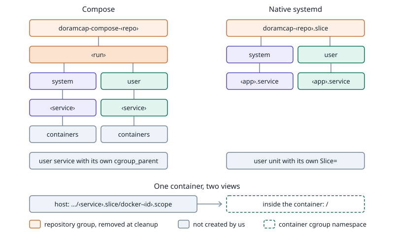

# Per-app cgroups

Created: 2026-11-12. [Implementation](111226-per-app-cgroups-impl.md).
Extends [system-app cgroup](110926-system-app-cgroup.md).

Each run owns one run group. Below it, `system` and `user` groups hold one group per
app, so CPU and memory are visible per app and cleanup removes one tree.

| Backend | Per-app group | Change |
| --- | --- | --- |
| Compose | One slice or directory per service; replicas share it | New for system and user services |
| Native systemd | The app's `.service` unit | New `‹repo›-user.slice` for user units |
| Supervisor | Out of scope | Keeps one run group |

- **User settings win.** A user service with its own `cgroup_parent`, or an adopted
  user unit with its own `Slice=`, keeps it and stays outside the run tree.
- **System apps stay enforced.** Their placement is always generated and verified.
- **User apps are placed only.** No post-start check.
- **Accounting is unchanged.** `system-app-cgroup.pb` records the `system` group.
- **Cleanup removes the run group** after its whole tree is empty, also for runs
  without system apps.

Systemd slice names escape `-` in app names (`my\x2dapp`) so names add no extra levels.
