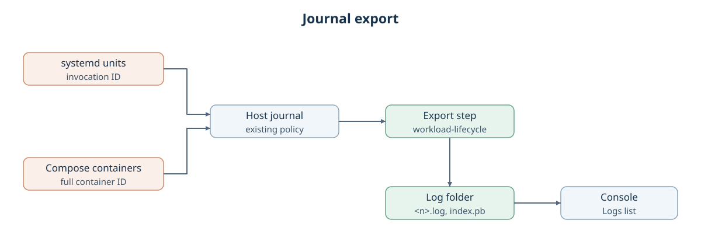

# Journal export

Created November 13, 2026. Status: implemented; downloads follow #354.
[Implementation plan](111326-journal-export-impl.md) ·
[Application logs for a run](111026-run-logs.md), the follow-up to
[Cutuy/doramcap#314](https://github.com/Cutuy/doramcap/pull/314).

After a run's programs stop, Console exports each program's entries still in the host
journal into one file per program in the run folder. Capture stays with the host
journal under its existing policy, as [option A](111126-run-log-capture-options.md)
selected. A saved file holds the entries still available; complete output stays unknown.

## Behavior

- **Which programs:** every unit a systemd run starts and every container a Compose run
  starts. Containers with project-managed logging are skipped and listed as such.
- **When:** after every program stops, before the run's cleanup finishes. Container
  entries stay queryable by full container ID after the container is removed.
- **Output:** one plain text file per program, one entry per line with its Unix timestamp in seconds and microseconds. Embedded line breaks are escaped.
- **Result:** a Logs list naming each program with exported, skipped or failed, and the
  file size. Downloads come with the [keep files plan](https://github.com/Cutuy/doramcap/pull/354).
- **Failure:** an export failure never changes the run's outcome. Files already written stay.

## Matching a program's entries

| Program | Identity recorded at start | Journal match |
| --- | --- | --- |
| systemd unit | Invocation ID, read from the service manager after start | `_SYSTEMD_INVOCATION_ID` for its own output, plus the service manager's entries carrying the same invocation |
| Container | Full container ID | `CONTAINER_ID_FULL` |

Unit names repeat across runs; invocation IDs and container IDs do not, so adjacent runs
never read each other's output.

## Run folder

| Path | Holds |
| --- | --- |
| `runs/<run id>/logs/<n>.log` | Program `n`'s entries |
| `runs/<run id>/logs/index.pb` | Each `n` with its program ID, identity, state, entry count and size |

Numbered files keep program IDs out of file names. The log folder is never mounted into
an app and is not in the change list. It follows run-folder retention.
The index starts with pending identities and is replaced atomically after each export.
Export streams one entry at a time without a file-size ceiling. Console displays indexes
up to 1 MiB; a larger index shows unavailable and leaves the files on the host.

## Owners

| Part | Owner |
| --- | --- |
| Program list and identities, export order | Each workflow: `compose-apps`, `workload-systemd`, later `workload-holoscan` |
| Export step, files and index | `workload-lifecycle` |
| Capture, rate limits, retention | Host journal |
| Logs list and downloads | Console |

## Failure and recovery

| Event | Result |
| --- | --- |
| Journal unavailable | Every program reads failed; the run outcome is unchanged. |
| Export stops part way | Written files stay; the program reads failed with the reason. |
| Run storage full | Same as a stopped export; cleanup still runs. |
| Program exited almost at once | Its last lines may lack an identity and be missing. |
| Console stops before export | Export during the next admission's reset from saved identities. |

## Decisions to make

| Decision | Options | Choice |
| --- | --- | --- |
| Export after a Console crash | Export during reset, or skip it | Owner chose export during reset from the single `logs/index.pb` written at start. Raise added recovery machinery if needed; skipping is the fallback. |
| Persisted record | One index, or separate startup identities | Orchestrator approved one atomic `logs/index.pb`: pending identities, then export results. |
| Reading the journal | `journalctl`, or a journal-reading crate | Owner chose `journalctl`; no new dependency. |
| Text format | Calendar timestamp, or Unix seconds | Unix seconds and microseconds; escape line breaks and backslashes. |
| Interrupted file | Replace it, or retain it | Retain the file and mark failed; count its complete saved entries. |
| Compose recovery policy | Parse preparation records, or label containers | Freeze policy in a reserved internal container label; recover IDs from owned containers. |
| systemd index locator | Duplicate identities, or point to the index | Private runtime symlink; the next admission resets the abandoned run. |
| Invocation fields | Two fields, or native invocation matches | Use all four native invocation fields for program, manager and object entries. |
| Console list | Saved status, or current index | Reread the index on Result and History; apply the explicit display budget. |
| Change-list exclusion | Per workflow, or lifecycle step | The shared filesystem preparation step excludes `logs`. |

Applicable rules: D-01 to D-03, D-06 to D-08, D-10, D-12, D-13; I-03, I-05, I-06, I-07.
