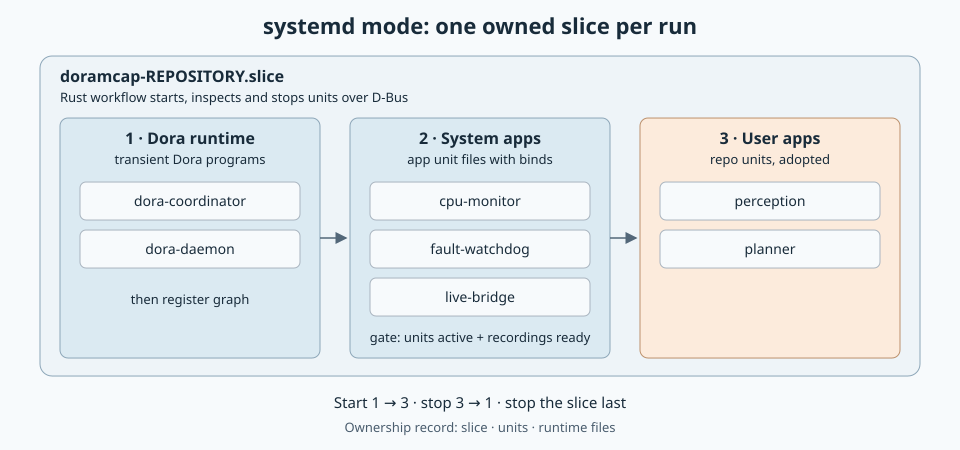
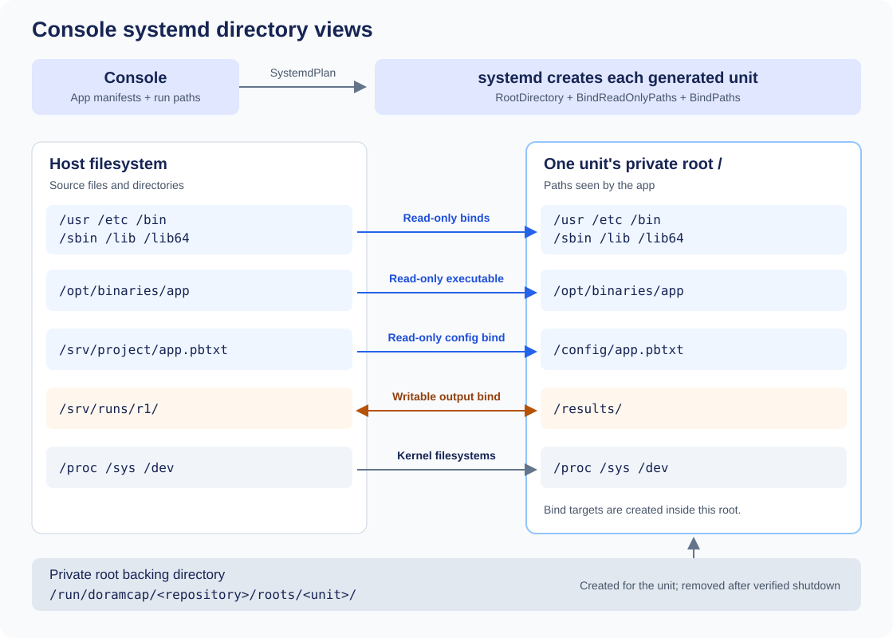

# systemd workload lifecycle

Run one experiment's apps as owned systemd units in a per-repository slice, controlled
over D-Bus. Groups start in order and stop in reverse; repository `.service` files are
adopted with native references preserved. Declared stop grace takes precedence over the plan fallback. An optional Dora coordinator and daemon start first as units; Dora CLI commands run as oneshot units. A failed unit is recorded and the run continues until stop.
Generated units use private roots with read-only host system directories and per-unit bind mounts.



[Compose directory view](../workload-lifecycle/docs/110726-compose-bind-mounts.svg)



```sh
cargo build --release --locked -p workload-systemd --example systemd_run
sudo target/release/examples/systemd_run run.pbtxt plan.pbtxt
sudo target/release/examples/systemd_run --cleanup /absolute/repository
```

Inputs: [`SystemdPlan`](proto/systemd_plan.proto). Needs root and the system service
manager. Native tests: [tests/native.rs](tests/native.rs); the Dora test reads a `dora`
binary path from `DORAMCAP_TEST_DORA`.
[Plan](../workload-lifecycle/docs/110726-launch-forms.md) · API: `cargo doc -p workload-systemd --no-deps`.

Admission refuses prior owned resources. A crash leaves units running and artifacts
intact until explicit cleanup. Normal shutdown waits for each unit's effective
stop timeout plus the reporting margin. Unconfirmed shutdown preserves resources
and skips recording finalization; unavailable required exit evidence fails the report.
