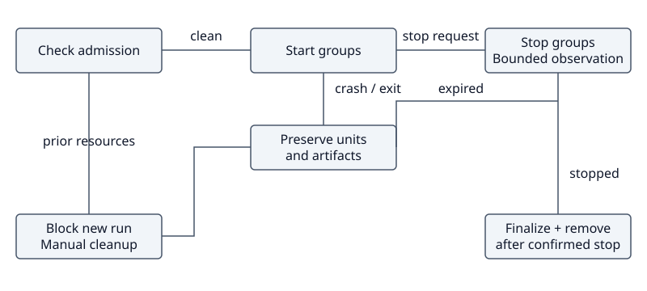

# PR 198 design decisions

Created: 2026-11-07. Scope: design record following the [PR 198 audit](110726-pr198-audit.md).
These decisions describe the intended revision. This draft changes documentation only.

## Accepted decisions

| Area | Decision |
| --- | --- |
| Ownership | Keep per-repository ownership, ordered start groups, reverse stop order and stop-request-driven run end. |
| Adoption | Reject unsupported service references before side effects. Dependency rewriting is deferred. |
| Service grace | Honor each service's declared shutdown grace. Use `RunPlan.stop_seconds` as the fallback when none is declared. |
| Observation | Use a distinct explicit finite observation budget for normal, awaited shutdown. Expiry reports incomplete shutdown, preserves artifacts and skips recording finalization. It does not override service grace or authorize an extra kill. |
| Abandoned runs | If Doramcap crashes or exits before cleanup finishes, leave owned units and artifacts as-is. |
| Admission | Refuse a new run with a clear diagnostic while prior owned resources remain. Cleanup is manual for now. |
| Recovery | Remove automatic pre-run reset from the intended revision. Automatic recovery is deferred. Normal run teardown remains in scope. |

The recovery decision supersedes the earlier proposal to share or split observation
budgets between shutdown and recovery. It also supersedes automatic pre-run reset
in the original M3 design for the intended revision. The original plan remains
unchanged so its implementation and validation history stay attributable.

## Remaining decisions

- Define the supported adopted-service reference rules precisely.
- Choose the shutdown observation field's location and exact deadline scope.
  A positive field in `SystemdPlan` and one deadline for the whole stop operation
  were proposed; they have not been accepted.
- Decide how unavailable required exit evidence affects report success.
  The current implementation substitutes empty strings or zero after read failures.

## Pending acceptance checks

- A failed or cancelled start retains every attempted unit for stop and reporting;
  recording finalization begins only after all writers are confirmed stopped.
- Units in one start group can start together; later groups respect the gate.
- Unsupported adopted-service references fail before dependent side effects.
- Service-declared grace and the fallback reach the intended units. Observation
  expiry reports incomplete shutdown and preserves artifacts.
- Crashed or abandoned units and files survive a later admission attempt; admission
  fails until manual cleanup. Normal awaited shutdown still removes owned resources.
- Filesystem discovery and cleanup failures prevent verified cleanup success.

These checks are pending implementation. Existing test results and validation
limits are recorded in the audit.
