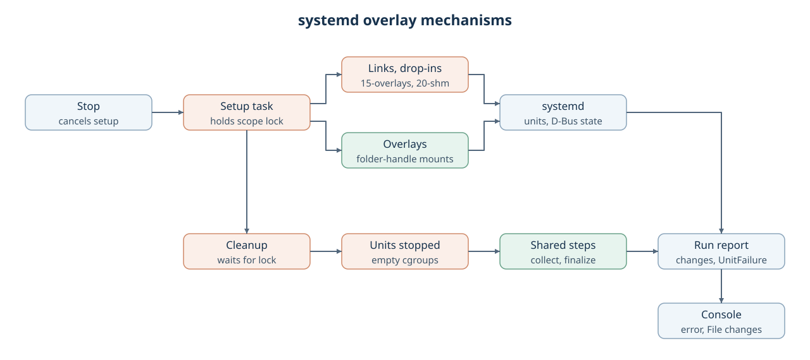

# systemd overlays: implementation plan

Created November 13, 2026. Updated November 14, 2026.
[Architecture and nine approved decisions](111326-systemd-overlays.md#approved-decisions).
Terms follow the [overlay term list](../../../console/docs/111026-file-change-report.md#terms).

## Mechanisms

| Owner | Code |
| --- | --- |
| `workload-systemd` | `runtime::Setup` checkpoints, scope lock, `15-doramcap-overlays.conf`, D-Bus `UnitFailure` |
| `host-filesystem` | `overlay::prepare_with_cancellation`, `/proc/self/fd` mount options, coverage notes |
| `workload-lifecycle` | `capture::{CollectFilesystemChanges, FinalizeOverlays}` |
| Console | Run error text, file-change reference |

`SystemdPlan.discard_writes` is interim; #361 replaces it with `RunPlan.write_policy`.

## Milestone 1: Native mount contract

**Work items**

- [x] Qualify controller mounts visible to transient and adopted units.
- [x] Use one owned drop-in to rebuild writable and read-only native binds.
- [x] Preserve destinations, access modes, recursive flags, order and native specifiers.
- [x] Use directory handles in kernel options and retain report paths.

**Validation**

- [x] Real systemd mount probe.
- [x] Native drop-in order and read-only binds.
- [x] Literal source path characters.

## Milestone 2: Review and source resolution

**Work items**

- [x] Resolve typed and native binds through shared overlay source resolution.
- [x] Hold repository admission and use Start names throughout user app Review.
- [x] Check private-root working directories without implicit binds.
- [x] Accept missing-ok directories; skip required RootImage directory checks and warn by app and path.
- [x] Canonicalize Dora runtime paths before matching overlay trees.
- [x] Attach untracked-write notes to shared sources and incomplete coverage.

**Validation**

- [x] Working-directory rejection before mounts.
- [x] RootImage Review warning.
- [x] Symlinked Dora runtime redirection.
- [x] Native specifiers and coverage notes.

## Milestone 3: Cancellation and failure

**Work items**

- [x] Stop pending setup at checkpoints and drain in-flight operations before cleanup.
- [x] Reconcile partial overlays, unit links and drop-ins; accept repeated Cleanup and Reset.
- [x] Capture systemd startup reasons before teardown and preserve them in run results.
- [x] Observe late systemd setup failures through native state notifications.
- [x] Verify unit state and empty kernel service cgroups before collecting changes.

**Validation**

- [x] Stop during partial setup.
- [x] In-flight operation settles before cleanup.
- [x] Cleanup twice.
- [x] Late native working-directory failure under both write policies.
- [x] Busy overlay and lingering writers.
- [x] Report-save failure and controller restart.

## Milestone 4: Shared finalization and compatibility

**Work items**

- [x] Use neutral filesystem step IDs for both backends.
- [x] Check stored events, run records and consumers; retain opaque legacy ID strings.
- [x] Update the demo's generated filesystem step identity.
- [x] Save file changes before unmount and policy application; carry results to Console.
- [x] Leave shared write-policy adoption in #361 and check the stacked follow-ups.

**Validation**

- [x] Legacy event decoding and display.
- [x] Compose and systemd change-record equivalence.
- [x] Write-back, discard and direct run output.
- [x] Owned runtime resources removed.

## Shared write-policy integration

**Work items**

- [x] Consume the filesystem-owned enum through `RunPlan.write_policy`; retire
  `SystemdPlan.discard_writes`, leaving tag 5 and its name unreserved.
- [x] Remove the temporary Console rejection; use shared plan validation for invalid policies.
- [x] Reuse saved checkpoints, saved positions and the confined opener for downloads.

**Validation**

- [x] Keep and discard for system apps and user apps.
- [x] Keep-copy failure preserves uppers.
- [x] Console Review, Result and downloads after restart.
- [x] Headless Chromium policy and download actions.

## Milestone 5: Explicit live host folders

**Work items**

- [x] Carry `passthrough_folders` from Console through the shared run plan and filesystem policy.
- [x] Use the shared source classifier for Review, overlays and saved coverage notes.
- [x] Preserve passed-through user binds in the reset drop-in, with source, flags and order.

**Validation**

- [ ] Equal, inside, containing and unrelated folder matches.
- [ ] Compose and systemd live sockets and direct writes beside an overlaid folder.
- [ ] Review and Result in Chromium.

Scripted regressions are TypeScript in [overlays.mts](../tests/overlays.mts).
Capability-required tests build unprivileged and elevate only the test executable.
