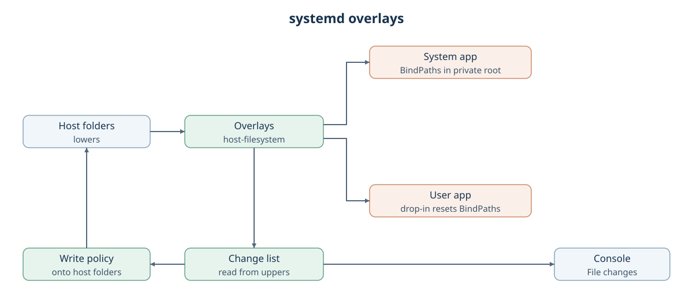

# systemd overlays

Created November 13, 2026. Status: implemented.
[Implementation plan](111326-systemd-overlays-impl.md) ·
[Overlays for writable mounts](../../../console/docs/111026-file-change-report.md), milestone 4.

A systemd run gets the same overlays, change list, write policy and report as a Compose
run. Terms follow the overlay design's [term list](../../../console/docs/111026-file-change-report.md#terms).

## Behavior

- Each writable host folder a unit declares gets one overlay before any unit starts.
- The unit receives the overlay directory at the path the app sees. Its read-only or
  writable setting stays as declared.
- After every unit stops, Console reads the uppers into the change list, saves the
  report, unmounts and applies the write policy.
- The result shows the File changes section that Compose runs already show.
- Everything else a unit can write is not tracked, and Review says so.

## Units and their writable mounts

| Unit | Declared writable mounts | How the overlay directory reaches it | Not tracked |
| --- | --- | --- | --- |
| System app | Writable binds in the app's settings | `BindPaths=` property of the transient unit, built in its private root | Nothing else is writable for it |
| User app | `BindPaths=` in the unit and its drop-ins | Owned drop-in that resets `BindPaths=` and restores both bind lists, in order, with overlay sources | Writes anywhere else on the host |

Console generates every system app's unit; a system app supplies no unit file.
Console reads a user app's settings through the service manager and the captured
unit copy. It adds no unit-file parser.

## Working directory

- A system app gets no mount for its working directory.
  Today Console adds one when no bind covers it; that mount goes away.
- Console checks that each declared working directory exists where the unit will run:
  at Review and again before anything is mounted or started. For a system app it
  looks inside the private root, so a host folder outside the declared binds is missing.
- `WorkingDirectory=-/path` accepts a missing directory and skips the check.
- A user app's writable working directory outside every writable mount is listed at
  Review as not tracked, with a suggestion to declare it.

## One run

1. **Review:** resolve the overlay plan and working directories; list not-tracked mounts.
2. **Start:** check working directories again, then mount every overlay.
3. **Launch:** create or adopt units with overlay directories in place of host folders.
4. **Stop:** stop every started unit and wait until none holds an overlay.
5. **Read uppers** into the change list and **save the report.**
6. **Unmount**, **apply the write policy** and **clean up** what the run owns.

Steps 4 to 6 reuse the shared steps Compose runs, ordered by `workload-lifecycle`.

## Owners

| Part | Owner |
| --- | --- |
| Units, drop-ins, working directory checks | `workload-systemd` |
| Overlays, change list, write policy | `host-filesystem` |
| Run order, admission, shared steps | `workload-lifecycle` |
| Report, preview, downloads | Console |

## Failure and recovery

| Event | Result |
| --- | --- |
| Working directory missing | Review or Start fails, naming the app and directory; nothing is mounted or started. |
| Overlay setup fails | No unit starts; only overlays this run created are removed. |
| A unit keeps running or holds an overlay | No final change list; the overlay stays mounted and blocks verified cleanup. |
| Console stops during a run | The next admission stops owned units, then discards leftover overlays. |

Recording checks, host `/dev/shm` handling and machine snapshots stay as they are.

## Decisions to make

| Decision | Options | Choice |
| --- | --- | --- |
| Shared step IDs | Keep `workload_docker::compose::…` for systemd too, or rename to neutral `workload_lifecycle::filesystem::…` | Owner chose a pure rename, subject to checking persisted contracts. |
| Replacing a user app's mounts | Reset `BindPaths=` in an owned drop-in and list every entry again, or patch the captured unit copy | Orchestrator approved one owned drop-in that resets `BindPaths=` and restores both native bind lists, preserving flags and order. |

## Limits

- Overlays need the service manager to see mounts Console makes. The first milestone
  checks this on a real host and stops the plan if it fails.
- A unit that writes outside its declared mounts is not tracked.
- A required working directory inside `RootImage=` is rejected before launch; it
  cannot be checked without mounting the image.

Applicable rules: D-01 to D-04, D-06, D-07, D-09, D-12, D-13; I-03, I-04, I-06, I-07.
