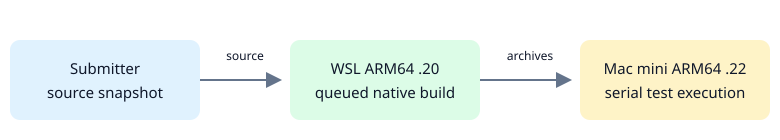

# Run-only ARM64 CI

Created: 2026-11-08.

The submitter snapshots source, queues native ARM64 builds on WSL `.20`, then
streams checksummed nextest archives and source to Mac mini Linux `.22`.
The Mac runs tests serially; a failed build stops transfer.

Matching paths under `/tmp/doramcap-ci-run-only` preserve embedded fixtures;
worker locks protect caches. The builder supplies nextest and Docker/Compose CLI
tools. Privileged BPF, doctests, application Node and CUDA checks use existing workers.

See the [README](../README.md#run-only-arm64-worker) for usage and requirements.

## Milestone: build and run

**Work items**

- [x] Queue native builds, transfer verified archives and run suites serially.
- [x] Use dependency-free TypeScript for worker, hashing and nextest installation.
- [x] Pin user-level Node on both hosts; retain logs and atomic completion status.

**Validation**

- [x] 45 CI-tool tests, TypeScript, boundaries and 19 Mac worker regressions.
- [x] Mac: 453 default, 459 all-feature and 65 storage tests passed; 199 existing skips, zero OOM kills.
- [x] Signals, child cleanup, lock recovery and invalid artifacts checked.
- [x] Fresh nextest installation and Node provisioning/reuse checked.

Evidence: code `02c530ac`, Pueue 629, job `55f7d5a80228400ebf1b8ab38055ee33` on both hosts.

## Milestone: native WSL job

**Work items**

- [x] Replace the full WSL job script with TypeScript; reuse process and lock handling.
- [x] Queue the pinned Node executable and verify the canonical worker in snapshots.

**Validation**

- [x] 51 CI-tool tests, type checks, ordering, snapshot integrity and cancellation.
- [x] Full WSL CI, native allocations and Dora recording; 977 Mac test executions passed.

Evidence: code `e122ec9e`, Pueue 631/632; Mac job `d725cbe7a3a740cb991393cbebec4a68`.
